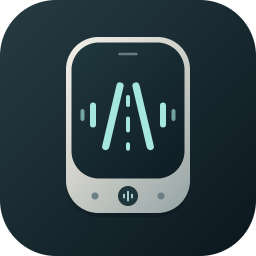

<p align="center">
  
</p>

# 小路 · 随声，同行。

**面向司机、车队和现场班组的语音优先群组对讲系统。**

小路（fleet-ptt）把“找人、建频道、邀请伙伴、开始对讲”放进同一套设备体验，让临时协作更容易开始。产品以自然语音作为主要交互入口，保留按住说话的 PTT 和必要按键，目标是减少现场作业中查找联系人、切换页面和操作菜单的负担。

当前交付是**连接真实业务服务和音频链路的浏览器 3D 对讲机原型**，用于验证交互、频道协作与音频体验，并为后续硬件设计提供依据。尚不是量产硬件或已完成现场验收的商用产品。

## 演示视频

| 视频 | 内容 | 观看与下载 |
| --- | --- | --- |
| 产品交互演示 · 约 88 秒 | 3D 外观、开机、文字昵称设置、公共频道、创建与分享频道、双身份成员同步、返回公共频道 | [观看第一版产品演示](docs/demo/xiaolu-product-demo.mp4) |
| 双端对讲演示 · 约 26 秒 | 小张与老王围绕“二号装货口”进行四轮短对话，两端同步显示发送与收听状态 | [观看新版对讲演示](docs/demo/xiaolu-voice-demo.mp4) |

两段视频均为 1080p MP4，收录于 [docs/demo](docs/demo/)。如果仓库文件页未显示播放器，可下载后观看。

- **产品演示**使用真实页面操作，配中文合成旁白和字幕；文字输入、点击操作不代表相应语音指令已经执行。
- **对讲演示**使用两种中文合成音色模拟司机，将音频注入浏览器麦克风输入，通过实际 PTT / 七牛 RTN 链路发送，成片声音取自远端接收音轨。它证明了该次模拟输入下的双端传输，不替代真人麦克风、扬声器、噪声、弱网或硬件验收。

## 核心功能

以下为当前原型提供的能力与设计交互；真实环境验证范围见[当前阶段与边界](#当前阶段与边界)。

| 能力 | 用户体验 | 解决的问题 |
| --- | --- | --- |
| 开机进入公共频道 | 完成身份与昵称设置后自动进入固定公共频道，默认收听 | 不必先配置车队归属，就能建立协作入口 |
| 自然语音控制 | 用“你好小路”发起查询、建频道、切频道、对讲和音量指令；指令键可手动唤醒 | 减少多级菜单和频繁点击 |
| 在线联系人与定向邀请 | 跨频道查询在线伙伴，创建或复用频道并发出邀请，对方接受后才切入 | 让临时装卸、集合和调度协作更直接 |
| 群组对讲与 PTT | 按住讲、松开停，也可用明确语音指令开始或结束发送 | 保留熟悉的对讲操作，清楚区分收听和发送 |
| 多频道协作 | 创建、加入、切换频道，返回上一频道或公共频道；支持口令与二维码分享 | 按任务组织沟通，减少无关信息干扰 |
| 身份与确认机制 | 设备独立凭证、昵称恢复；昵称修改与口令入群需要确认，同名目标先澄清 | 降低重复设置和误操作的负担 |
| 可操作的 3D 设备 | 金属与玻璃外观、真实状态驱动的屏幕和按键、设备内指令手册及手动入口 | 在投入硬件之前验证操作布局和使用流程 |

### 一次典型协作

> 以下是目标语音流程示例，完整语音闭环仍需按验收矩阵实测。

1. 小张和老王开机，完成昵称设置，进入公共频道收听。
2. 小张：“你好小路，谁在线？”
3. 小张：“你好小路，邀请老王加入装货频道。”
4. 老王收到邀请，说“接受”，两人进入同一频道。
5. 小张按住 PTT：“老王，你到哪儿了？”老王回复：“快到了，还是二号口？”
6. 协作结束，小张：“你好小路，回到公共频道。”

邀请不会强制对方切换频道：拒绝后留在原频道；邀请两分钟有效，离线不排队，同名联系人先澄清。按住 PTT 发送、松开停止；语音开始的持续对讲可通过结束指令或指令键停止。普通聊天内容不作为裸词指令处理，断线不会自动恢复发送。

## 使用场景与商业价值

小路聚焦**需要快速找人、临时组队、短句沟通的现场协作**。下表描述预期价值与试点方向，不代表已经取得的客户收益。

| 场景 | 典型需求 | 预期商业价值 |
| --- | --- | --- |
| 物流车队与装卸场站 | 临时司机集合、确认装货口、协调进出场 | 降低入组与联系成本，减少反复拨号和查找群聊的操作 |
| 园区、工地与仓储班组 | 不同岗位按任务组建临时频道 | 缩短沟通组织过程，让信息集中到相关人员 |
| 调度与现场负责人 | 查找在线伙伴，邀请到指定作业频道 | 提升人员联络的直接性，并由接收者决定是否加入 |
| 对讲设备与终端合作方 | 验证语音入口、按键布局和状态反馈 | 在硬件选型和制造投入之前，通过原型更早发现体验问题 |

### 可探索的商业化方向

- **终端与服务组合**：面向车队或场站，探索设备交付与云端对讲、语音服务的组合方案。
- **场景试点与部署服务**：围绕装卸、园区或班组协作提供部署、接入和运维支持，先验证使用频率与效果。
- **硬件合作接入**：基于设备协议与业务工具接口，与终端厂商验证产品集成，逐步形成软硬件协同方案。

这些是商业化方向，尚未包含计费、套餐、完整组织后台或量产交付。试点应衡量入组耗时、联系成功率、任务内沟通次数、语音识别成功率、对讲延迟与稳定性，并结合 RTN、云端识别和部署运维成本评估可持续性；当前没有经验证的效率提升比例或投资回报数据。

## 当前阶段与边界

- **已展示**：真实页面上的设备启动、文字昵称设置、频道创建与加入、成员同步及切换；合成语音输入经实际 PTT 链路的双端传输。
- **仍需联合验收**：真人语音昵称设置、唤醒与连续指令、智能体工具调用和邀请播报的完整流程，以及驾驶室噪声、口音、回声、弱网和双端听感。详细状态以[验收记录](docs/acceptance.md)为准；演示片段不等于验收矩阵全部通过。
- **云端语音**：待命及对讲期间的麦克风音频会上传灵矽识别，可能产生额度消耗。对讲中，整句唤醒词及指令可能在 STT 返回前被频道听到；希望避免外传时，应先松开 PTT 或按指令键停发。
- **浏览器运行**：页面隐藏时暂停语音，回到前台恢复；不承诺后台或锁屏常驻。首次麦克风权限需要用户授权。
- **硬件与范围**：3D 外观不是制造级结构图。硬件客户端、续航、天线、声学及量产仍待验证；当前不提供 IM、地图、支付、录音摘要或完整组织后台。

## 技术组成

| 层次 | 组成与职责 |
| --- | --- |
| 设备原型 | React、TypeScript、Three.js：3D 外观、按键、屏幕、音频采集与状态反馈 |
| 业务服务 | Go、SQLite：设备身份、会话、频道、联系人、邀请与设备动作回执 |
| 对讲音频 | 七牛 RTN：频道内实时音频发布与订阅 |
| 语音智能体 | 灵矽：语音识别、语义理解、参数追问和语音播报 |
| 工具接入 | Streamable HTTP MCP：将智能体意图连接到带身份、权限及确认校验的业务操作 |

指令音频通过 `/api/v1/linx/ws` 桥接到灵矽，普通对讲音频通过 RTN 传输。设备启动时按 `mac_id` 检查并自动完成灵矽绑定。原型使用服务端生成的 `device_id`、`mac_id` 和 `device_credential`；未来硬件按同名字段预配身份。

服务端在唤醒后等待设备停止对讲的回执，再开放业务工具与播报。TTS 期间暂停识别上传，播放结束后恢复；播报后保留 20 秒补充或确认窗口，成功开始对讲后回到唤醒待命。首次昵称设置使用独立受限连接，不开放频道业务。

## 本地启动

### 配置服务

准备 Docker / Docker Compose，并从示例创建配置文件：

```bash
cp .env.example .env
```

编辑 `.env`，填写以下配置。真实密钥仅保存在本地，勿提交仓库。

| 配置 | 用途 |
| --- | --- |
| `SESSION_SECRET` | 会话签名，替换为足够长的随机值 |
| `QINIU_ACCESS_KEY`、`QINIU_SECRET_KEY`、`QINIU_RTN_APP_ID` | 七牛 RTN 房间凭证；占位符不能完成真实进房 |
| `LINX_API_KEY`、`LINX_AGENT_ID` | 灵矽设备接入与“小路”智能体 |
| `LINX_MCP_TOKEN` | 私有 MCP 的独立随机鉴权密钥 |
| `PUBLIC_BASE_URL` | 灵矽能够访问的服务公网基址 |

完整语音联调还需用 HTTPS 公网地址或隧道暴露 `{PUBLIC_BASE_URL}/api/v1/mcp`，在灵矽私有自定义 MCP 中选择 Streamable HTTP，配置请求头 `Authorization: Bearer <LINX_MCP_TOKEN>`，并将其关联到“小路”智能体。参见[灵矽接入方案](docs/linx-access.md)。浏览器麦克风使用 HTTPS 或 localhost。

### 启动与停止

```bash
make up
```

浏览器访问 <http://localhost:8080>。`make up` 执行 `docker compose up --build`，数据目录 `data/` 挂载到容器 `/data`。

```bash
make health  # 进程探活，不代表语音和 RTN 已验收
make down   # 停止并移除容器
```

双端体验请准备两个独立浏览器配置文件或设备，使用不同昵称，并保持页面在前台；真人测试建议佩戴耳机，避免回声。普通的两个标签页不应当作两个独立设备使用。

### 开发运行

需要本机 Go 与 Node.js/npm。`make server` 从进程环境读取配置，不会自动加载 `.env`；在服务端终端先导入配置，并将 Docker 示例中的数据库路径改为本地路径：

```bash
set -a
source .env
set +a
export SQLITE_PATH="$PWD/data/fleet-ptt.db"
make server
```

另一个终端启动前端：

```bash
make web
```

`make web` 安装前端依赖并启动 Vite，将 `/healthz`、`/api` 及 WebSocket 代理到 Go 服务。`make server` 默认使用 `web/dist` 托管静态资源和 `data/fleet-ptt.db` 保存数据；数据库路径可通过配置覆盖。

## 更多文档

- [产品设计方案](docs/product-design.md)：场景、外观、语音交互、确认规则与范围。
- [详细技术方案](docs/technical-design.md)：服务、设备协议与实现设计。
- [灵矽接入方案](docs/linx-access.md)：智能体、MCP 和设备语音接入。
- [验收记录](docs/acceptance.md)：真实环境验证步骤、证据与待完成事项。
