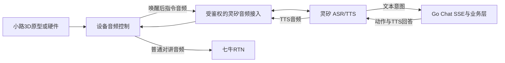

# 灵矽接入方案：小路语音对讲机

本文件定义小路 3D 原型和未来硬件的灵矽接入方式。依据灵矽公开文档：[第三方应用接入](https://linx.qiniu.com/docs/xrobot/guide/third-app)、[WebSocket 协议](https://linx.qiniu.com/docs/xrobot/platform/websocket)、[OTA](https://linx.qiniu.com/docs/xrobot/platform/OTA)。本仓库不保存灵矽密钥；设备注册、握手和音频格式必须在授权环境中实测。

## 1. 产品链路

小路把指令音频交给灵矽完成 ASR/TTS，把多人对讲音频交给七牛 RTN。灵矽不承载多人 PTT；Go 业务层负责意图执行、频道、成员、权限和设备动作。浏览器 3D 原型通过本项目的 `/api/v1/linx/ws` 连接真实灵矽设备协议，Go 服务端保存灵矽凭证并完成桥接。



指令键按下后，3D 原型通过项目端 WebSocket 建立真实灵矽设备连接，发送 PCM 音频和 `listen start/stop`。灵矽完成 ASR 后以 HTTP POST + SSE 请求业务服务，业务服务返回的 `message` 由灵矽合成 TTS，再通过同一 WebSocket 返回音频。完整本地联调需要公网隧道让灵矽访问业务回调地址。

## 2. 设备协议事实

灵矽第三方设备握手要求这些 HTTP 头：

- `Authorization: Bearer <token>`
- `Device-Id`：MAC 或由硬件 ID 生成的伪 MAC
- `Client-Id`：UUID
- `Protocol-Version: 1`

握手后设备发送 `hello`，上行音频为平台支持的二进制 Opus 或 PCM，采样率、帧长和结束标志以授权环境实测为准。OTA 注册使用设备 ID 与请求体 `mac_address`，同样需要硬件信息。

浏览器原生 `WebSocket` 不能设置这些自定义握手头，因此小路 3D 原型按以下优先级接入：

1. 验证灵矽是否提供可用于浏览器的官方 Web 接入；
2. 若没有，使用服务端建立受鉴权的音频桥接，由服务端连接灵矽设备协议；
3. 未来硬件优先使用对应平台的设备 SDK 或固件协议。

不把浏览器直接伪装成灵矽设备作为默认前提，也不把灵矽控制台页面作为小路最终交互入口。

## 3. 音频桥接职责

桥接服务只连接经过授权的设备和灵矽端点，灵矽凭证只存服务端。它负责：

- 设备注册、凭证和连接生命周期；
- 握手头、`hello` 和协议版本；
- 音频编码、采样率、帧长和结束采集；
- ASR 音频上行与 TTS 音频下行；
- 应用设备会话与灵矽侧 `mac_id` 映射；
- 取消、超时、断线、关机和并发会话释放；
- 不向浏览器暴露灵矽长期凭证，不接受浏览器指定任意设备目标。

协议验证必须记录：握手结果、实际音频格式、ASR 延迟、TTS 格式与播放完成信号、断线恢复、并发限制和资源消耗。不能假定浏览器 `MediaRecorder` 输出可直接发送；根据平台支持选择 AudioWorklet PCM 或匹配的编码方案。没有实时 ASR 文本时，设备只显示采集状态和最终识别文字。

## 4. 身份与会话

### 4.1 自动设备绑定

服务端只配置灵矽 API Key 和智能体 ID。模拟设备注册时生成 `device_id`、`mac_id` 和 `device_credential`；真实硬件在工厂预配这三项信息。设备按下电源键后，使用设备凭证调用 `/api/v1/device/boot`，服务端按该设备的 `mac_id` 检查状态：已绑定设备复用 WebSocket 凭证，未绑定时先向 OTA 接口上报设备信息，读取返回的 6 位激活码并调用 `POST /xiaozhi/device/bind/{agentId}/{deviceCode}`，随后调用 OTA 激活确认并重新上报，取得 WebSocket URL 和设备 Token。验证码只在服务端 API 链路中使用，不需要用户打开控制台手动输入。

API Key、设备 Token 和智能体 ID 只保存在服务端环境变量，不返回浏览器、不写入数据库，也不提交到仓库。

用户、应用设备和灵矽设备是独立对象。服务端建立经过授权的映射：

```text
应用设备 ID ──绑定──> 用户 ID
应用设备 ID ──映射──> mac_id
应用设备 ID ──连接──> 活动 WebSocket / 音频会话
```

设备 ID 只用于定位，不作为用户凭证。绑定前验证设备归属；同一设备只允许一个当前频道和一个上行状态。语音首次设置只允许初始化昵称和绑定，完成后签发正常设备会话；不能开放未鉴权的通用音频代理。

灵矽 Chat 回调使用：

- `auth.device_id`（灵矽侧 mac_id）定位已授权的应用设备映射；
- `details.msg` 作为本轮识别文本；
- `details.session_id` 关联本轮对话与动作；
- `Authorization: Bearer <LINX_CHAT_TOKEN>` 校验回调来源。

动作还需要由服务端生成唯一 `action_id`，处理重复回调、取消、迟到结果和设备断线。`session_id` 只表示灵矽会话，不能单独充当业务幂等键。

## 5. Chat SSE 业务契约

Go 接收 `POST /api/v1/linx/chat`，校验请求类型、Bearer、设备映射、会话 ID 和动作权限。响应返回一条 `message` 和一条 `message_end`；`message` 的 `details.answer` 用于 TTS，`details.intent` 表示动作类型，`session_id` 原样回传。

支持的意图：

| 意图 | 作用 |
|------|------|
| `create_channel` | 创建并进入频道，逐位播报口令 |
| `join_channel` | 按口令或名称加入；口令先复述 |
| `confirm_join` / `cancel_join` | 确认或取消待加入动作 |
| `switch_channel` | 按名称或序号切换 |
| `previous_channel` | 回到上一次成功使用的频道 |
| `talk_start` / `talk_end` | 请求开始或结束对讲 |
| `list_my_channels` | 播报频道列表与当前频道 |
| `list_speakers` | 播报正在讲话的成员 |
| `show_join_code` / `show_join_qr` | 播报口令或控制屏幕展示二维码 |
| `set_volume` | 调整本设备播放音量 |
| `set_nickname` | 复述并确认后修改昵称 |

口令为 6 位，去掉 `0/O`、`1/I`；中文数字和分隔符先归一化再校验。缺少参数时追问，同名或歧义时澄清。口令确认窗口为 2 分钟，过期或无待办的确认不执行动作。业务失败也返回可播报的 `answer`。

SSE 文案只表示业务处理结果；设备动作、房间切换、音频发布和本地音量必须通过设备控制层执行并上报结果。业务层不能仅凭 SSE 写成功就播报“已发送”或“已切换”。

## 6. TTS、回声与对讲互斥

- “开始对讲”的提示音播放完成后才允许 RTN 发布。
- 检测到“你好小路”后立即阻断 RTN 上行，再开始指令采集。
- TTS 播放期间暂停灵矽监听和指令上传，防止设备自唤醒。
- 指令期间降低或暂停远端对讲播放，防止远端声音进入识别。
- 远端播放、扬声器回声、耳麦和驾驶室噪声需要实测；未通过测试不承诺零误唤醒。
- 首版接受唤醒检测完成前的少量片段可能被频道听到；检测后不得继续上传指令音频。

## 7. 实施验收

先完成灵矽官方 Web 接入或音频桥接验证，再实现 3D 原型内指令。验收覆盖：

- 设备注册、授权和会话绑定；
- “你好小路”连续说法与对讲中唤醒；
- 建群、口令确认入群、切群、回切和开始/结束对讲；
- TTS 播报、远端回声和指令/RTN 音频互斥；
- 取消、过期、重复回调、迟到回执和设备断线；
- TTS/ASR 音频格式、延迟、并发与资源释放；
- 设备动作成功/失败与屏幕、指示灯、业务状态一致。

在授权环境完成上述实测前，不能把浏览器原型或 Chat SSE 回调标记为小路硬件语音闭环完成。
