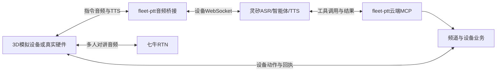

# 灵矽接入方案：小路语音对讲机

本文件定义 3D 模拟设备和真实硬件的统一灵矽接入方式。依据官方 [云端 MCP](https://linx.qiniu.com/docs/xrobot/mcp/software-mcp)、[MCP 服务管理](https://linx.qiniu.com/docs/xrobot/guide/mcp-store)、[WebSocket 协议](https://linx.qiniu.com/docs/xrobot/platform/websocket)、[OTA](https://linx.qiniu.com/docs/xrobot/platform/OTA) 及 [MCP Streamable HTTP 传输规范](https://modelcontextprotocol.io/specification/2025-06-18/basic/transports) 文档。真实密钥只保存在本地或部署环境。

## 1. 职责与链路

灵矽的“小路”智能体负责 ASR、自然语言理解、参数追问、工具选择和 TTS。fleet-ptt 是业务服务，通过云端 MCP 提供频道、成员、对讲和设备操作，校验身份、权限和确认状态，并返回执行结果。多人对讲音频由七牛 RTN 承载。

开机、完成昵称设置并允许麦克风后，设备通过 `/api/v1/linx/ws` 以 realtime 模式持续上传 PCM。服务端根据灵矽 STT 文本开头的“你好小路”唤醒，也接受“小鹿”“小陆”两个同音转写，不接受“小度”等其他变体。指令键也可触发；待设备回执确认 RTN 上行已停止后，才允许 MCP 业务工具与 TTS 输出。灵矽理解整句指令、调用工具，并根据结果合成播报。首次昵称通过 `/api/v1/device/setup/ws` 的受限语音设置完成，文本输入为兜底；语音改名在已建立的业务会话内执行。

云端唤醒使用灵矽 STT，不使用本地唤醒模型。官方协议的 auto 表示设备触发的唤醒模式，listen.detect 表示设备报告已经检测到唤醒词，均不能替代云端识别。未唤醒时服务端过滤工具和音频输出，但音频仍交给灵矽，ASR 和模型可能消耗额度。对讲中返回整句 STT 前，整句唤醒和指令可能已经通过 RTN 传给频道，MVP 接受这一边界。

## 2. 统一设备身份与开机

| 字段 | 用途与来源 |
| --- | --- |
| `device_id` | fleet-ptt 应用设备标识；模拟设备由注册接口生成，硬件预配 |
| `mac_id` | 灵矽 OTA、设备绑定和 WebSocket 的设备标识；模拟设备生成虚拟 MAC，硬件预配 |
| `device_credential` | 证明设备身份；客户端安全保存，服务端只保存摘要 |

除身份生成/预配外，两类设备使用相同流程：

1. 模拟设备调用 `POST /api/v1/device/register` 获取身份；硬件在预配阶段取得相同字段及服务端设备记录。量产预配工具另行实现。
2. 按电源键后，以 `device_id` 和 `device_credential` 调用 `POST /api/v1/device/boot`。
3. 服务端按 `mac_id` 检查灵矽绑定。未绑定时上报 OTA，读取激活码，调用 `POST /xiaozhi/device/bind/{agentId}/{deviceCode}`，完成激活确认并重新获取 WebSocket 信息；激活码只在服务端 API 链路中使用，无须人工填写。
4. 本地无业务会话时，先携带设备凭证向 `POST /api/v1/device/session` 提交空字符串 `nickname` 尝试恢复；仅返回 400（尚未设置昵称）才进入受限语音设置，其他失败提示恢复错误。首次设置时，小路询问称呼，用户说“我叫老王”“叫我老王”或直接昵称，小路复述后等待下一句“确认”。收到确认结果后，通过 `POST /api/v1/device/session` 提交昵称；文本输入保留为兜底。已有用户通过同一 HTTP 接口恢复会话，后续语音改名通过 MCP 执行。
5. 开机自动进入公共频道，建立 `/api/v1/device/ws` 业务信令及 `/api/v1/linx/ws` 语音连接，使用相同的业务事件、动作、回执和音频协议；RTN 只收听，用户按 PTT 或明确要求开始对讲后才发送。无需预先归属车队。
6. 关机或断线停止采集、播放和 RTN 发布，释放连接；恢复后同步频道，不自动恢复讲话。

服务端配置全局 `LINX_API_KEY` 和 `LINX_AGENT_ID`，按设备获取并在内存保存灵矽 WebSocket 凭证。应用 `device_id` 不代替灵矽侧 `mac_id`，标识本身不能证明设备归属；客户端不能指定别人的设备或任意上游端点。

### 2.1 首次昵称的受限语音连接

设备连接 `GET /api/v1/device/setup/ws`，在五秒内发送首帧 `{"type":"authenticate","device_id":"…","device_credential":"…"}`。服务端仅接受凭证有效且尚未绑定用户的设备，使用该设备真实灵矽连接提供 STT 和 TTS；不允许任意音频代理目标，也不开放频道等业务工具。

通过 `onboarding` 消息的 `start`、`playback_done`、`cancel` 控制设置流程。服务端以 `speaking` / `listening` 状态驱动提示与采集，`speaking` 携带本轮 `turn_id`；收到 `confirmed` 及 `nickname` 后，设备关闭设置连接并用已有 `/api/v1/device/session` 保存昵称。`playback_done` 必须携带匹配的 `turn_id`，服务端已收到上游 `tts.stop` 且设备实际播放完毕后才能转为监听。播报期间暂停采集上传；设置阶段无需唤醒词。`speaking` 状态忽略 `start` / `cancel`，指令键通过关闭连接并重连来重新询问，避免迟到 TTS 混入下一轮。

称呼解析使用直接昵称及“我叫 / 叫我”等固定前缀；复述之后下一句独立的“确认 / 确定 / 是的 / 对 / 没错”才完成设置，“取消 / 不对 / 不是 / 重新设置”会清空候选并重新询问。候选确认窗口两分钟，设置连接总时限五分钟，单轮播报上限六十秒。断线或关机不保留未确认昵称，页面进入后台也会关闭设置连接。每轮固定提示使用独立的灵矽上游 WebSocket，首轮复用初始连接，后续提示关闭旧上游后重新握手；本地设置连接保持不变。服务端按上游连接 `epoch` 丢弃旧消息，避免 STT 自动回答与固定复述混淆，无需发送 `abort`。确认后保存失败可直接重试保存已确认昵称，不重新设置。真实联调需检查 STT、复述 TTS、播放回执、确认、超时、恢复及文本兜底，不以协议测试代替声音验收。

## 3. 音频桥接与硬件适配

灵矽设备 WebSocket 握手使用 `Authorization: Bearer <token>`、`Device-Id`、`Client-Id` 和 `Protocol-Version: 1`。本项目由 Go 桥接服务发送这些头，浏览器与硬件都连接 fleet-ptt，不需要持有灵矽 API Key 或设备 Token。

桥接协商 PCM，上传 16 kHz、单声道、16 bit 小端音频，通过 realtime 监听获得整句 STT。下行按 hello.audio_params.format 解码：PCM 为 16 bit 小端有符号样本，直接按返回采样率播放；Opus 才使用 AudioDecoder，包类型为 key。设备需要实现持续采集、PCM 帧发送、唤醒通知确认、TTS 解码/播放、实际播放完成回执和资源释放。浏览器共享一个麦克风采集源，RTN 使用克隆轨；硬件也应共享音频输入源，分别编码给灵矽和 RTN。

设备收到唤醒通知后先停止 RTN 上行，再回执本轮标识；服务端等待回执期间不执行工具。TTS 期间暂停灵矽上传，静音 RTN 输入并降低远端播放，只有播放缓冲排空后才恢复监听；不能把收到 tts.stop 当成扬声器播放完成。实际播放完成后保留 20 秒继续交流窗口；成功开始对讲后则返回唤醒待命，普通对讲话语不触发指令。处理上限 30 秒，播报保护上限 60 秒。浏览器页面隐藏时暂停语音，返回前台后恢复；关机、断线须释放资源，不能由迟到事件恢复发送。音频格式、平台限制、延迟和真实 SDK 行为以联调结果为准。

硬件适配范围为按键/屏幕、音频输入输出、网络与 RTN SDK。公共频道、在线查询、定向邀请及接受/拒绝、昵称、口令确认、音量和动作回执继续沿用设备接口；本方案的工具运行在云端 MCP 服务，不要求固件实现设备端 MCP 工具服务。设备执行 `action` 后向业务 WebSocket 返回 `action_result`，只对当前活动连接生效；收到取消或断线后不得因迟到结果恢复发送。

### 3.1 设备语音控制消息

以下 `wake` 消息在设备与 fleet-ptt 的 `/api/v1/linx/ws` 之间交换，不转发给灵矽。硬件和浏览器使用同一协议；它们不属于 MCP 工具参数。

| 方向 | 消息 | 设备处理 |
| --- | --- | --- |
| 服务端 → 设备 | `{"type":"wake","state":"detected","session_id":"…","turn_id":"…","text":"你好小路，切到装货"}` | 停止 RTN 上行，成功后回执本轮 `turn_id`；失败则取消，不能假报就绪 |
| 设备 → 服务端 | `{"type":"wake","state":"ready","turn_id":"…"}` | 表示该轮停止上行已完成，允许服务端继续处理 |
| 设备 → 服务端 | `{"type":"wake","state":"manual"}` | 指令键开启继续交流窗口；之后的 STT 仍走停止上行和 ready 流程 |
| 设备 → 服务端 | `{"type":"wake","state":"playback_done","turn_id":"…"}` | TTS 实际播放结束后发送，不能提前至收到 tts.stop 时 |
| 设备 → 服务端 | `{"type":"wake","state":"cancel"}` | 取消当前轮次，回到待命 |
| 服务端 → 设备 | `{"type":"wake","state":"followup","timeout_ms":20000}` | 保留 20 秒继续交流窗口，无需重复唤醒词 |
| 服务端 → 设备 | `{"type":"wake","state":"standby"}` | 清理当前轮次和播放，恢复等待唤醒 |

未匹配唤醒词的待命转写以 `{"type":"wake_missed","text":"…"}` 返回当前设备，供屏幕提示识别结果，不执行工具或播报，不将转写写入服务端日志。

`turn_id` 仅在当前语音连接内有效，设备不得复用上一轮标识。停止上行确认最长等待 2 秒；未及时确认时本轮调用拒绝执行。设备在播放中暂停 PCM 上传，关机或断线释放所有轨道与播放缓冲。

### 3.2 主动邀请播报

邀请通过 `/api/v1/device/ws` 的 `invitation` 事件跨频道发送给在线目标设备，字段见技术方案的设备 WebSocket 协议。服务端先下发 `announce_invitation` 动作，`value` 为邀请 JSON，设备校验接收者、前台状态和语音就绪，显示提示后按普通动作协议返回 `action_result`。服务端随后发送 `wake.detected`，设备停止 RTN 上行并返回本轮 `wake.ready`；播报内容由服务端根据保存的有效邀请生成，不允许客户端提交任意播报文本。服务端经真实灵矽 WebSocket 的 `listen.detect`、`text_response` 请求播报。这个轮次只允许 TTS，不开放业务工具；播放结束后开放 20 秒回答窗口。用户说“接受”或“拒绝”才进入正常 STT/MCP 指令流程。

邀请两分钟有效、每个接收者最多一项待处理，保存在内存中，服务重启失效；同一发起者同频道重试不延长有效期。离线、语音未连接或正忙时提示失败，不排队；拒绝和超时不会改变当前频道。接受时设备先停止旧频道发送，再加入/切入目标频道，媒体就绪后回执；硬件也须实现屏幕提示和相同协议。浏览器后台语音暂停；后台、语音断线或忙碌导致投递失败时邀请失效，发起者已完成的频道创建/切换不回滚。不以信令在线或上游接收请求等同于已听到。

## 4. 云端 MCP 协议与鉴权

### 4.1 连接

- 初始化、通知、`ping`、`tools/list` 和 `tools/call` 统一发送到 `POST /api/v1/mcp`，正文为 JSON-RPC 2.0，`Content-Type: application/json`，`Accept: application/json, text/event-stream`。
- 服务对请求返回 HTTP 200 与 `application/json` 格式的 JSON-RPC 结果；成功接收通知后返回 HTTP 202 空响应。
- 协商使用 `2025-06-18` 协议版本，客户端按 `initialize` 结果使用对应版本。
- `initialize` 响应通过 `Mcp-Session-Id` 头分配会话。客户端后续请求携带该会话头及协商的 `MCP-Protocol-Version`，先发送 `notifications/initialized` 再调用工具。
- `DELETE /api/v1/mcp` 携带相同会话与鉴权头结束会话。服务不提供独立推送流，GET 返回 HTTP 405，属于 Streamable HTTP 允许的行为。
- 所有请求携带 `Authorization: Bearer <LINX_MCP_TOKEN>`；凭证缺失或未配置时拒绝访问。
- 反向代理必须转发 POST/DELETE，以及 Bearer、MCP 会话/协议和平台身份头；保留初始化响应的 `Mcp-Session-Id`。

### 4.2 平台身份

灵矽设备会话调用云端 MCP 时，平台自动提供以下 HTTP 请求头：

| 请求头 | 校验方式 |
| --- | --- |
| `X-Linx-Device-Id` | 与已授权应用设备的 `mac_id` 匹配 |
| `X-Linx-Agent-Id` | 必须等于配置的 `LINX_AGENT_ID` |
| `X-Linx-Session-Id` | 必须存在，用于关联灵矽会话 |

初始化与该 MCP 会话的后续请求必须携带一致的身份头。这些信息来自已鉴权的平台请求，不是工具参数。模型不能通过参数切换目标设备。控制台发现工具时可以不带设备上下文，允许初始化和 `tools/list`，但调用业务工具必须有完整且匹配的设备、智能体和会话身份。使用实际设备会话完成业务联调，不能把控制台工具发现成功当作设备调用成功。

服务端还校验当前设备对应的灵矽语音连接和唤醒窗口；未唤醒、未收到停止 RTN 上行回执或窗口过期时拒绝工具执行。设备的本地轮次标识用于关联停止/播放完成回执，灵矽 MCP 没有提供同一标识，不能据此推断迟到的工具调用对应哪一句话。真实平台的 STT 与 MCP 到达顺序、跨轮迟到调用需要专项验证。

`Mcp-Session-Id` 标识 MCP 传输会话，灵矽会话 ID 用于关联对话，JSON-RPC `id` 用于识别请求，设备 `action_id` 用于动作回执。它们不能互相替代。同一 MCP 会话内相同请求 ID 的重试复用结果，不能用同一 ID 提交不同请求；跨 MCP 会话或进程重启不承诺业务幂等。服务最多保留 128 个活动会话；会话空闲 30 分钟后失效，每个会话最多记录 1024 个请求，达到请求上限需重新初始化。会话失效返回 HTTP 404，客户端需重新初始化，不能将重新初始化后的业务调用视为已去重。

同一 MCP 会话内工具调用串行执行，最长执行 30 秒。POST 连接断开不会取消已经接受的调用，客户端可在原 MCP 会话内用相同 JSON-RPC ID 重试并获取结果；`notifications/cancelled` 或删除 MCP 会话会取消执行等待，但不回滚已经落库的业务结果。

### 4.3 工具

工具参数以 `tools/list` 返回的 JSON Schema 为准；业务层同时校验参数。灵矽负责将自然语言转换为明确参数，缺少信息时追问，不把用户原话交给业务层做关键词路由。

| 工具 | 参数 | 行为 |
| --- | --- | --- |
| `list_online_members` | 无 | 查询其他在线用户的昵称和稳定用户 ID，不限频道 |
| `invite_member` | `name`，以及 `recipient_name` / `recipient_id` 二选一 | 复用发起者已加入的唯一同名频道或创建、切入并邀请；同名成员需用完整用户 ID |
| `accept_invitation` / `reject_invitation` | 可选 `invitation_id` | 接受或拒绝本人有效邀请；省略时使用当前唯一待处理邀请 |
| `create_channel` | `name` | 创建并进入频道，返回口令 |
| `join_channel` | `code` 或 `name`，二选一 | 按口令先生成待确认事项；按名称加入，同名时要求澄清 |
| `confirm_action` | 无 | 执行当前设备、当前灵矽会话的有效口令入群或改名待办 |
| `cancel_action` | 无 | 清除当前设备、当前灵矽会话的待办 |
| `switch_channel` | `name` 或 `index`，二选一 | 切换到已加入频道；序号从 1 开始 |
| `previous_channel` | 无 | 返回上一频道 |
| `talk_start` / `talk_end` | 无 | 开始或结束对讲 |
| `list_my_channels` | 无 | 查询频道列表和当前频道 |
| `list_speakers` | 无 | 查询当前频道讲话成员 |
| `show_join_code` / `show_join_qr` | 无 | 查询口令或让设备显示二维码 |
| `set_volume` | `level`（0–100 整数）或 `adjustment`（`up`/`down`），二选一 | 设置绝对音量或增减 10 个百分点 |
| `set_nickname` | `name` | 生成改名待办，复述后等待确认 |

口令为六位，使用去掉 `0/O`、`1/I` 的字符集；智能体将中文数字和分隔符转换为明确口令，服务端仍校验格式。口令入群与昵称修改的确认窗口为两分钟；无待办、取消或过期后不能执行。同设备的另一灵矽会话不能确认该待办；无关的新业务指令清除该设备的待办。服务端校验待办、会话与有效期，用户是否明确确认由智能体依据对话判断，需在角色指令中要求下一轮确认并在真实联调中验证。

工具结果为标准 MCP `content` 文本和 `isError` 标志。业务错误要反馈给智能体，由其说明失败原因。需要本地执行的切群、开始/结束对讲、音量、二维码和改名复用设备 WebSocket 动作与回执；创建/加入频道还需观察对应频道事件和媒体进房状态，不能仅凭数据库写入或 MCP 响应成功推断真实音频成功。

## 5. 配置灵矽智能体与本地隧道

1. 在 `.env` 填写 `SESSION_SECRET`、RTN 凭证、`LINX_API_KEY`、`LINX_AGENT_ID`。生成独立随机值作为 `LINX_MCP_TOKEN`，勿把 API Key 当作 MCP Token。
2. 启动本地服务，将 HTTPS 公网隧道指向 Go 服务（默认本地 8080 端口）。把隧道基址填入 `PUBLIC_BASE_URL`。隧道须支持 MCP 的 POST/DELETE 及 WebSocket。可使用 ngrok 账号分配的固定开发域名，重启时继续指定同一域名；若使用临时域名，更换后须同步更新配置。
3. 在灵矽控制台的“自定义 MCP”创建私有服务，协议选择 **Streamable HTTP**，地址填写 `https://<隧道域名>/api/v1/mcp`，请求头设置 `Authorization: Bearer <LINX_MCP_TOKEN>`。初始化与工具调用共用该地址。
4. 将该 MCP 开通并关联到“小路”智能体的技能/扩展，保留智能体模型用于语义理解。确认它能发现工具列表。官方 API 也可创建服务、订阅并配置智能体 MCP 关联，操作关联列表时需保留其他已选择 MCP。
5. 在角色指令中要求：频道/对讲/设备操作必须调用业务工具；根据工具结果回答；缺参数先追问；需要确认时先复述，用户明确确认后才调用 `confirm_action`；不得猜测设备身份、成功状态或频道口令。收到邀请意图时使用邀请工具，由服务端完成频道解析/创建，不先独立创建频道；同名成员使用返回的稳定用户 ID 澄清；自己有多个同名频道时改用其他明确的频道名。接受/拒绝使用邀请工具，不误用口令或改名的 `confirm_action`。
6. 用 3D 原型开机完成自动绑定与昵称设置，建立业务及语音连接，允许麦克风后，确认自动进入公共频道后，说“你好小路，谁在线”和“你好小路，邀请老王加入装货频道”开始真实音频测试；指令键作为手动入口。

控制台配置项：

| 配置项 | 值 |
| --- | --- |
| 传输协议 | `Streamable HTTP` |
| URL | `https://<隧道域名>/api/v1/mcp` |
| 请求头名称 | `Authorization` |
| 请求头值 | `Bearer <LINX_MCP_TOKEN>` |

不要在控制台固定填写 `Mcp-Session-Id` 或设备身份头：MCP 会话由初始化返回，设备身份由灵矽在实际设备会话中提供。凭证使用部署时的真实值，不提交到 Git。

## 6. 真实联调与验收边界

需要依次验证：设备开机绑定、首次语音昵称询问/复述/确认与保存、音频握手、ASR、MCP 工具发现、设备身份请求头、工具调用、业务 WebSocket 动作回执、TTS 和 RTN 双端实际声音。记录设备/MAC、灵矽会话 ID、JSON-RPC ID、action_id、时间和结果，日志不记录凭证。

覆盖开机进入公共频道、在线目录、跨频道创建并邀请、接受/拒绝、同名澄清、离线/过期/重复邀请、建群、确认入群、切群/回切、开始/结束对讲、音量、昵称和邀请信息；检查未唤醒时普通讲话不触发工具/播报、完整连续说法、20 秒继续交流窗口及过期重新唤醒、无效身份、缺参、业务失败、确认过期、重复请求、断线和迟到回执。TTS 播放期间的监听暂停、远端回声、驾驶室噪声、连续说法和对讲中唤醒需要独立音频测试。浏览器后台/锁屏和硬件常驻能力分别记录。

当前尚未完成真实灵矽全链路联调。自动化协议与业务测试验证服务端契约，不能代替平台实际请求头、工具选择、音频格式、唤醒或 RTN 听感的验证；验收记录见 [acceptance.md](./acceptance.md)。
