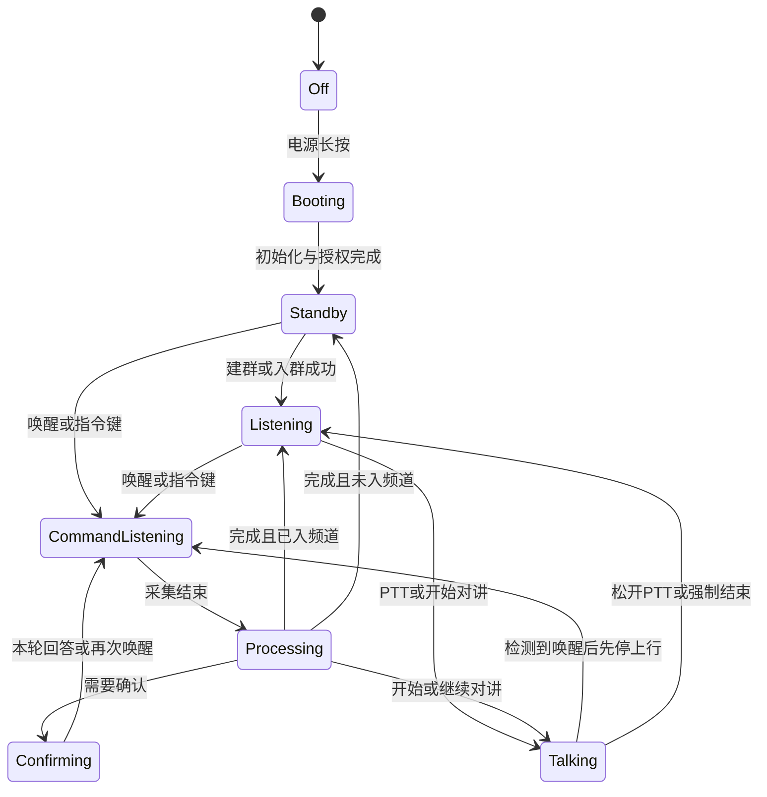

# fleet-ptt 产品设计方案：小路智能对讲机

面向司机 / 车队的语音优先对讲设备，角色名称为 **小路**。用户通过自然语音完成频道和对讲操作，必要按键用于开关机、唤醒兜底和紧急结束。

第一阶段交付可实际操作和通话的 **3D 虚拟对讲机**，验证未来硬件的外观布局、状态反馈和语音闭环。所有日常业务入口都在设备原型内，不依赖页面外的频道表单或另一个灵矽页面。

## 1. 设计状态与范围

本文件定义小路产品与 3D 原型的目标体验。功能开发、灵矽接入和硬件联调按文档中的实施阶段与验收标准推进。

| 项 | 定义 |
|----|------|
| 用户 | 司机、调度、队长、工地班组长 |
| 使用场景 | 驾驶 / 装卸时双手占用，需要入群、切群、收听和讲话 |
| 最终载体 | 类似对讲机的硬件设备；主控、操作系统和器件待选型 |
| 当前设计交付 | 浏览器中的 3D 交互原型，操作连接真实业务与音频 |
| 交互原则 | 开机及首次授权后，核心业务通过语音完成；按键兜底 |
| 产品边界 | 不做 IM、地图、支付、完整组织后台、开放域闲聊或全程 VOX 自动上麦 |
| 制造边界 | 3D 交互模型不是可开模结构图；续航、声学、天线与结构需真机验证 |

技术实现见 [详细技术方案](./technical-design.md)，灵矽协议与接入要求见 [灵矽接入方案](./linx-access.md)。

## 2. 名称与语音入口

- **角色名：小路。** 设备提示、屏幕文案和演示统一使用该名称。
- **首版拟用唤醒词：你好小路。** “小路小路”作为可测试备选，不要求同时启用；最终以驾驶室噪声、口音和误唤醒测试确定。
- 已唤醒的一轮指令、补充参数与确认无需重复唤醒词。完成或取消后回到待命，下次新指令重新唤醒。
- 支持“你好小路，切到装货”的连续说法，也支持先唤醒、听到“我在”后再说指令；不得截掉连续说法中唤醒词后的内容。
- 设备播报简短、明确；成功必须有实际执行依据，未识别时说明可说的话，不把回声复述视为执行成功。

示例：

> 用户：“你好小路，创建一个装货频道。”
>
> 小路：“装货频道建好了，口令是 3、8、4、2、K、9。”
>
> 用户：“你好小路，开始对讲。”
>
> 小路提示音后开始发送。用户：“前车注意，前方有施工。”
>
> 用户：“你好小路，结束对讲。”
>
> 小路停止发送，提示“已结束”，恢复收听。

## 3. 外观与必要控件

概念外观采用短天线、竖屏、大侧键，黑灰机身与橙色 PTT。机身可先按约 125 × 58 × 32 mm、天线约 45 mm 建模；尺寸只用于视觉与握持比例，不约束最终器件布局。

仅保留三个实体控件，不设置频道旋钮、方向键或独立菜单确认键：

| 控件 | 位置建议 | 操作与行为 |
|------|----------|------------|
| 电源键 | 顶部 | 长按约 1.5 秒开关机；关机释放采集、播放、房间与连接 |
| 指令 / 结束键 | 侧面 | 单击唤醒；对讲中先停上行再进入指令；采集中再次单击结束采集；长按强制停止发送并取消指令 |
| PTT 大键 | 侧面主要握持区 | 按住讲、松开停；未入频道时提示先加入，不开始发送 |

正面保留屏幕、指示灯、扬声器和麦克风孔。背夹、包胶、天线等补全形态，不添加无需求的交互功能。

原型控件要求：

- 按键有按压位移、触摸命中区、名称提示和键盘可操作能力。
- PTT 的松开、指针取消、窗口失焦均解除发送；麦克风尚在打开时松开也不得随后自动发送。
- 指令期间按住 PTT：取消当前指令和播报；已入房时转为按住讲话，未入房则提示。
- 长按指令 / 结束键总能回到收听或未入频道；短按与长按不能重复执行。
- 开机后的正常业务不依赖触屏；屏幕内文本输入、列表选择保留作调试与手动兜底。

## 4. 语音能力与确认规则

| 用户表达 | 设备行为 |
|----------|----------|
| “创建一个装货频道” | 创建并进入，逐位播报口令 |
| “加入口令三八四二K九” | 归一化口令、复述并等待确认 |
| “确认加入” / “取消” | 确认待办或取消，不需重新唤醒 |
| “进入装货频道” | 按名称加入；同名时澄清 |
| “切到卸货” / “切到第二个” | 停止上行并切到已加入频道 |
| “我有哪些频道” | 播报序号、名称与当前频道 |
| “回到上一个频道” | 返回本设备上次成功使用的频道 |
| “开始对讲” / “继续对讲” | 提示音后持续发送 |
| “结束对讲” | 停止发送，恢复收听 |
| “音量小一点” / “音量调到百分之六十” | 调整本设备播放音量 |
| “谁正在讲话” | 播报当前频道讲话成员 |
| “我的口令是什么” | 显示并逐位播报当前频道口令 |
| “显示邀请二维码” | 在屏幕显示当前频道二维码 |
| “我叫张师傅” / “把昵称改成张师傅” | 复述确认后设置昵称 |

规则：

1. 口令为 6 位，沿用去掉 `0/O`、`1/I` 的字符集；中文数字归一化后仍需检查合法性。示例统一用 `3842K9`。
2. 口令入群必须复述后确认；确认窗口为 2 分钟，采集无需持续打开两分钟。监听窗口结束后可重新唤醒继续确认；过期不得执行。
3. 缺少参数时追问；同名频道或指令歧义时澄清，不猜测目标。
4. 切频道、音量和查询不额外确认；更改昵称和口令入群需确认。取消或无关新指令清除待确认事项。
5. “正在发送”表示本机媒体已成功发布，不等同于音量检测出的实际说话；成员数量不等同在线人数。
6. 暂无待确认事项时说“确认”，应明确说明，不沿用已执行或已过期操作。

## 5. 唤醒、指令与对讲音频

### 5.1 默认工作方式

开机并完成授权后，设备默认收听频道，同时在本地监听唤醒词。未入频道也可唤醒以创建或加入频道。只有唤醒后的指令音频交给灵矽，日常对讲音频只走七牛 RTN。

唤醒后，通过静音结束检测或指令键结束采集；连续说法无需等待设备先播报“我在”。唤醒、静音、无输入和处理超时的具体时间由真机及浏览器验证确定，不把未验证参数作为协议要求。

### 5.2 对讲中唤醒

1. 对讲持续发送期间，本地唤醒检测仍工作。
2. 检测到“你好小路”后立即停止频道上行，随后采集指令。
3. 执行“结束对讲”“切到卸货”等指令，播报结果后回到收听。
4. 只有明确说“开始对讲”或“继续对讲”，或重新按住 PTT，才恢复发送。

检测完成前的唤醒词片段可能已被频道听到，首版接受这一边界；检测后不得继续把指令音频送入频道。若未来要求唤醒词也不外泄，需要评估发送缓冲与延迟取舍。

不直接从普通对讲话语中匹配裸词“结束”“切换”，不采用全程 VOX 自动上麦。本地唤醒监听不等同于一直向云端上传。

### 5.3 播报与回声

- 设备自身 TTS 期间暂停指令上传及唤醒触发；返回键语义由指令 / 结束键承担，仍可物理打断。
- 指令期间降低或暂停远端播放，避免别人的语音进入指令识别；完成后恢复。
- 收听时远端讲话与本地唤醒并存，需要验证回声消除、耳麦和扬声器条件下的误触发；未通过前不能声称全双向声学隔离已完成。
- “开始对讲”的播报或提示音应在媒体发布前结束，避免本机提示音被发送给频道。

## 6. 状态机与反馈

状态分为电源/连接、业务音频、屏幕导航三组，避免把所有组合做成一个巨大枚举。

任意运行状态均可关机；取消、超时或失败回到收听/未入频道，不自动恢复上行。断线先停止发送并提示，恢复连接后重新确认房间状态，不自动恢复讲话。

| 状态 | 屏幕 | 指示灯 | 音频反馈 |
|------|------|--------|----------|
| 未入频道 | “你好，我是小路。可以说创建频道” | 待命灯 | 首次引导 |
| 可收听 | 当前频道与讲话成员 | 绿色常亮 | 入房短音 |
| 被唤醒 / 指令采集 | “我在，请说”或识别文字 | 蓝色呼吸 | 简短应答 |
| 指令处理 | “正在切换到卸货” | 蓝色闪烁 | 避免重复播报 |
| 待确认 | 复述口令或昵称 | 蓝色常亮 | 询问确认或取消 |
| 正在发送 | 频道与发送时长 | 橙色常亮 | 开始/结束短音 |
| 异常 | 原因与下一步 | 红色闪烁 | 一次简短提示 |

“正在发送”以本地媒体发布成功为准；“已切换、可收听”以目标房间连接成功为准，服务端业务写入成功不是完整媒体成功。

## 7. 屏幕与 3D 交互

屏幕逻辑尺寸建议约 240 × 320，信息保持可读：当前频道、工作状态、讲话成员、识别文字、执行结果和音量。不显示虚假的电量、蜂窝信号或网络质量；若演示模拟值，必须标记模拟。

设备内页面包括：启动、首次设置、频道主页、频道列表、口令输入、邀请二维码、成员、指令及确认、设置、异常提示。昵称和频道名优先语音输入；浏览器的文字兜底使用屏幕内输入框与系统键盘。

- 默认操作视角为正面轻微偏转，能看到屏幕和侧面 PTT。
- 拖动背景可旋转观察，操作按钮时不拖动机身；手机端默认固定操作视角。
- 页面外只允许回正、缩放等观察辅助，不放业务操作。
- 状态灯、屏幕、按钮动画由真实设备状态驱动，文字与声音共同表达，不只依靠颜色。
- 扫码使用宿主摄像头，取景显示在设备屏幕中；未来真机若不带摄像头，保留二维码展示，由配套手机扫码。不开启摄像头也能通过语音口令完成入群。

## 8. 首版范围与交付顺序

| 阶段 | 内容 | 验收 |
|------|------|------|
| 1. 灰模与控制层 | 三个按键、设备屏幕、频道与对讲业务 | 无页面外业务按钮即可完成手动闭环 |
| 2. 原型内指令 | 按键唤醒、采集、灵矽接入、执行和播报 | 不跳转灵矽页面，真实完成指令；协议验证应尽早开展 |
| 3. 本地唤醒 | “你好小路”、连续说法、对讲中唤醒 | 免手动完成核心业务，测试噪声与回声 |
| 4. 外观完善 | 正式模型、材质、按键动画与灯光 | 桌面与手机均可操作，显示与实际状态一致 |

最终演示：开机及首次授权 → 语音设置昵称 → 建群并播报口令 → 第二客户端确认加入 → 开始/结束对讲 → 切群与回切 → 音量调整 → 查询口令及展示二维码。除开机和浏览器首次权限授权外，核心业务不依赖点击。

验收还包括：未入房讲话提示、无效口令、取消/过期确认、识别失败、媒体失败、PTT 快速松开、指令与上行互斥、关机释放资源、断线不自动恢复发送。双端实际音频与灵矽联调必须有实测记录，测试替身不能替代。

不包含：多机型皮肤、拆装物理仿真、录音摘要、组织后台、地图、制造级 CAD、真机固件和量产设计。浏览器后台/锁屏与真机常驻监听能力不同，不能用网页演示推断硬件续航和后台可靠性。
