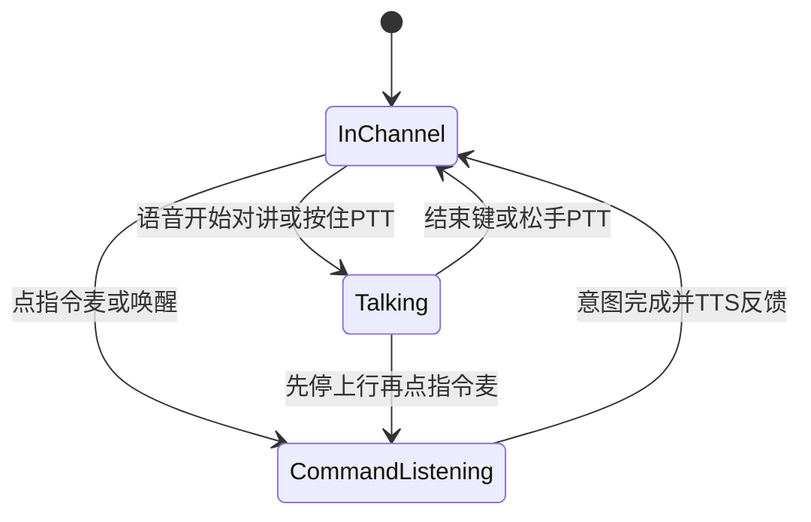
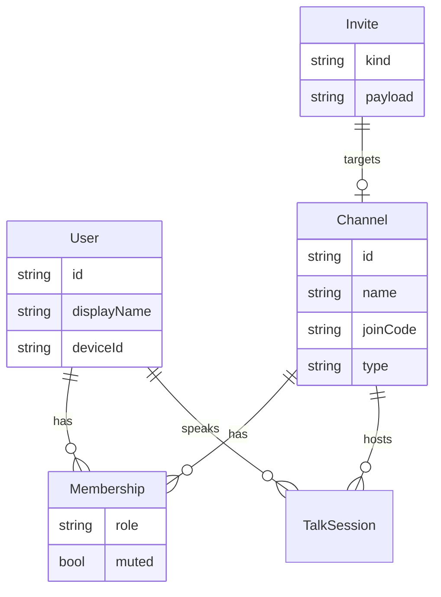
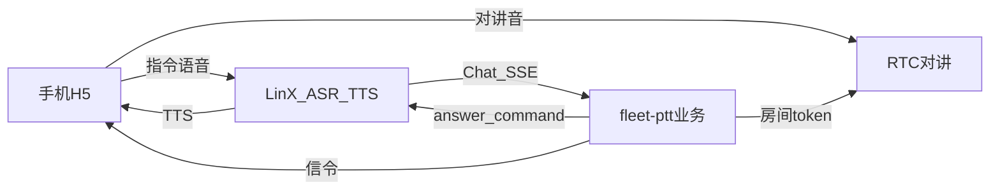
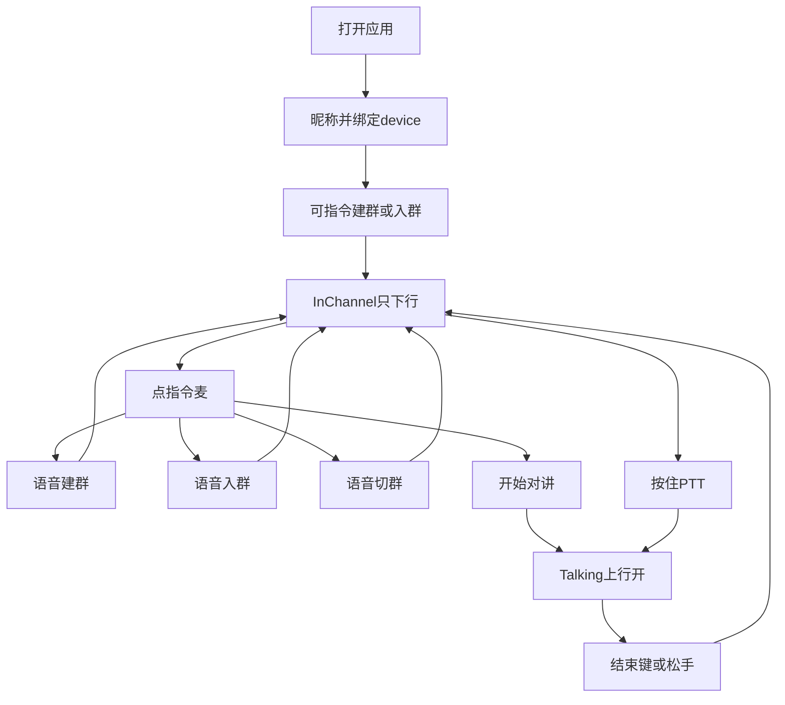

# fleet-ptt 产品设计方案

面向司机 / 车队场景的群语音对讲产品。语音免手动为主路径，手势为兜底；指令层接入灵矽（LinX），对讲媒体自建 RTC。

参考：[灵矽文档中心](https://linx.qiniu.com/docs/xrobot/)、[第三方应用接入](https://linx.qiniu.com/docs/xrobot/guide/third-app)、[云端 MCP](https://linx.qiniu.com/docs/xrobot/mcp/software-mcp)、[WebSocket 协议](https://linx.qiniu.com/docs/xrobot/platform/websocket)。

---

## 1. 产品定位

**一句话：** 让司机基本不动手，靠一句话进对车队频道，再对着说话。

| 项 | 定义 |
|----|------|
| 用户 | 司机为主；调度、队长、工地班组长同构可用 |
| 核心场景 | 驾车 / 装卸时双手占用，仍要进群、切群、对讲 |
| 交互原则 | 语音优先（经灵矽意图）+ 手动兜底；主路径不依赖点选 |
| 差异点 | 语音建群 / 入群 / 切群 + 语音开始对讲；非 IM、非电话会议 |
| 产品边界 | 不做社交动态、地图导航、支付、完整组织后台；对讲不做全双工会议产品形态 |

**角色（简化）：**

- **成员**：语音进群、对讲、切群
- **创建者 / 队长**：语音建群、邀人（创建者即管理员，不做细粒度权限）

**客户端：** 手机 / 平板 H5（可 PWA）；嵌入式车载端按同一房间协议预留。

---

## 2. 交互模型与状态机

指令走灵矽；对讲走 RTC。状态上区分「在频道可听」与「正在讲」，并避免「对讲中完全关闭指令导致无法结束」的死锁。

| 模式 | 用户怎么用 | 系统做什么 |
|------|------------|------------|
| **InChannel（在频道空闲）** | 已有当前频道 | RTC **只订阅下行**（能听别人）；可进入指令 |
| **CommandListening（指令）** | 点指令麦（主路径）；常驻唤醒词为后续增强 | 音流走灵矽 ASR → 业务意图 → TTS |
| **Talking（对讲）** | 「开始对讲」或按住 PTT | RTC **上行开启**；上行默认不送给灵矽 |
| **手动兜底** | PTT、结束键、列表切群、口令输入、扫码 | 嘈杂或浏览器限制时仍可用 |

### 结束对讲

1. **主路径：** Talking 时点「结束」键；或松手 PTT（与传统对讲机一致）
2. **可选：** 先停上行，再点指令麦说「结束对讲」
3. **不做：** 在对讲音频里实时抽取「结束」唤醒词（易误触、难稳定）

### 主路径故事

1. 点指令麦：「加入口令 384291」→ 入群并成为当前频道（可听）
2. 点指令麦：「切换到装货」→ TTS「已到装货」
3. 点指令麦：「开始对讲」→ Talking，对着说话
4. 点结束 / 松手 PTT → 回到 InChannel，继续听别人

**不做全程 VOX 自动上麦：** 驾驶室噪声易误触发。

**AI 能力边界：** 意图分类 + 槽位（频道名、口令等）；不做开放域闲聊。

---

## 3. 概念模型

| 概念 | 说明 |
|------|------|
| 频道（Channel） | 对讲一等公民，对外可称「群」 |
| 当前频道 | 同一时刻只订阅 / 上麦一个频道 |
| InChannel | 已进 RTC，仅下行 |
| Talking | 上行打开 |
| 身份绑定 | fleet-ptt 用户（昵称）与灵矽侧 `device_id` / 会话绑定，指令落到正确端 |
| 指令会话 | 经灵矽短时进行，结束有 TTS + Toast |

---

## 4. 功能地图

### 4.1 建群 / 入群

| 能力 | 说明 | 优先级 |
|------|------|--------|
| 语音入群 | 「加入口令 xxxxxx」「进装货群」 | P0 |
| 语音建群 | 「建一个装货频道」 | P0 |
| 口令手动输入 | 兜底 | P0 |
| 扫码入群 | 兜底；队长展示给新人 | P0 |
| 行程 / 运单号 | 「进运单 YD1024」自动建或加入 | P1 |
| 车牌 / 车队号 | 「进浙A车队3」 | P1 |
| 临时群到期解散 | | P2 |
| 组织架构拉人 | 企业版 | 后期 |

### 4.2 对讲

| 能力 | 说明 | 优先级 |
|------|------|--------|
| 语音开始对讲 | 指令：「开始对讲」 | P0 |
| 结束对讲 | 结束键 / 松手 PTT | P0 |
| 按住 PTT | 大按钮：按下讲、松开停 | P0 |
| 成员与说话态 | 谁在说 | P0 |
| TTS 状态反馈 | 「已开始对讲」等 | P0 |
| 耳麦 / 扬声器 | 系统能力 | P0 |
| VOX 自动上麦 | | P2 |
| 通话摘要 | 离线文字摘要 | P1 |
| 车载降噪 | | 后期 |

### 4.3 切群

| 能力 | 说明 | 优先级 |
|------|------|--------|
| 语音切群 | 「切到装货」「切到频道 2」 | P0 |
| 列表点选切群 | 兜底 | P0 |
| 最近频道回切 | 「回到上一个」 | P1 |

匹配频道名 / 别名 / 序号 → TTS「已切换到装货」→ 切换媒体；失败明确提示，不静默。

### 4.4 多端

| 能力 | 说明 | 优先级 |
|------|------|--------|
| 手机 / 平板 H5 | 语音主路径 + 手动兜底 | P0 |
| 第二端演示 | 同口令进房，双侧对讲 | P0 |
| 嵌入式薄客户端 | `join` / `talk_start` / `talk_end` / `switch_channel` | 预留 |
| 硬件唤醒键 / 物理 PTT | 车载 | 后期 |

### 4.5 账号与安全

| 能力 | 说明 | 优先级 |
|------|------|--------|
| 昵称进入（可无短信） | 与灵矽 device / 会话绑定 | P0 |
| 手机号登录 | | P1 |
| 口令防刷 / 过期 | | P1 |
| 踢人、禁言 | | P2 |

---

## 5. MVP 范围

### 5.1 演示闭环

1. 语音创建频道 → 得到口令（TTS 逐位播报）
2. 第二台设备：语音念口令加入（可对比手动输入）
3. 「开始对讲」→ 双方听到 → 结束键或松手结束上行
4. 已加入 ≥2 个频道，语音切群后继续听 / 讲
5. 手动 PTT、扫码、列表切群作为同屏可见兜底

### 5.2 MVP 包含

- 指令一律走灵矽 ASR / TTS；fleet-ptt 做意图落地与 RTC 信令
- 对讲媒体自建 RTC
- 昵称 + device 绑定
- 上述演示闭环全部能力

### 5.3 MVP 不包含

- 原生 App、常驻唤醒词、对讲声里识别「结束」
- 组织后台、地图、IM、真嵌入式硬件、VOX
- 用灵矽传输多人对讲媒体
- 云端 MCP 不作为 MVP 阻塞项（可后挂同构工具）

---

## 6. 灵矽分层接入

**原则：指令层接灵矽；对讲房间自建 RTC，灵矽不承载多人 PTT。**

| 灵矽能力 | 用法 |
|----------|------|
| 第三方业务 Chat（SSE） | **主路径**：ASR 后文字 → fleet-ptt → answer / command |
| WebSocket 设备语音 | 指令麦采集入口 |
| 云端 MCP | 与 Chat 同构的 Tool，可后挂，不阻塞主路径 |
| 端侧 MCP / 固件 / OTA | 车载后续 |
| 多人 PTT / 混音 | 不使用；自建 RTC |

### 6.1 职责划分

- **灵矽：** ASR、TTS、把用户话以 Chat SSE 交给业务
- **fleet-ptt：** 频道 / 成员 / 口令 / 切群 / 开停讲；下发 RTC 房间 token；经本机信令控制 H5 上下行（不能只回灵矽，否则浏览器无法开麦）
- **身份：** 首次进入生成或沿用 `device_id`，与昵称用户绑定

### 6.2 业务能力（Chat 意图同构）

| 能力 | 行为要点 |
|------|----------|
| `create_channel(name)` | 返回口令；TTS **逐位**播报 |
| `join_channel(code \| name)` | 口令建议复述确认一次，降低 ASR 听错 |
| `switch_channel(name \| index)` | 切群前若 Talking，先停上行 |
| `talk_start()` / `talk_end()` | 同时信令到客户端控制 RTC 上行 |
| `list_my_channels()` | 供语音列举 / 选择 |

### 6.3 H5 与灵矽设备协议

灵矽设备协议偏硬件（如 Device-Id）。实现时验证其一即可保持产品分层不变：

1. H5 作为伪设备连接 WebSocket  
2. 官方 Web / 小程序等入口承载指令  
3. 双页演示：指令在灵矽侧页面，对讲在 fleet-ptt H5（通过绑定与信令对齐）

**接入结论：** MVP 采用双页。浏览器不能按灵矽设备协议设置 WebSocket 握手头，因此本仓库 H5 不充当伪设备。指令在灵矽侧页面，对讲在 fleet-ptt H5，两边用同一个 `device_id` 对齐。核对记录见 [灵矽接入结论](./linx-access.md)。

---

## 7. 关键流程与页面结构

### 对讲页信息架构

- **顶栏：** 当前频道名 + 状态（可听 / 指令中 / 正在讲）+ 成员数  
- **中部：** 成员列表与「正在说」指示；大号状态文案便于余光扫视  
- **底部：** 大按钮 PTT（按住讲）；**结束**；**指令麦**；频道列表入口弱化  

---

## 8. 产品规则

1. 全局仅一个当前频道；切群前若处于 Talking，先停止上行。  
2. InChannel 可听；Talking 才上行；指令音流与对讲上行默认分离。  
3. 结束对讲以结束键 / 松手为主，不依赖对讲声里识别「结束」。  
4. 允许多人同时上行（RTC 混音）；不做抢麦 floor 控制。  
5. 语音操作必须有明确成败反馈（TTS + Toast）。  
6. 口令短、可读、可口述；创建后 TTS 逐位读；语音入群对口令做一次确认。  
7. 昵称用户与灵矽 device / 会话绑定。  
8. 可无短信登录；数据轻量持久化即可。  
