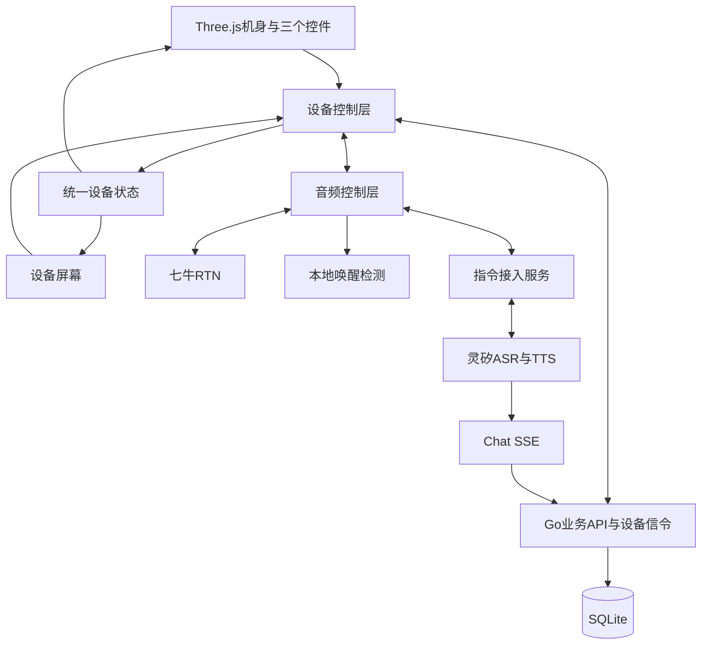
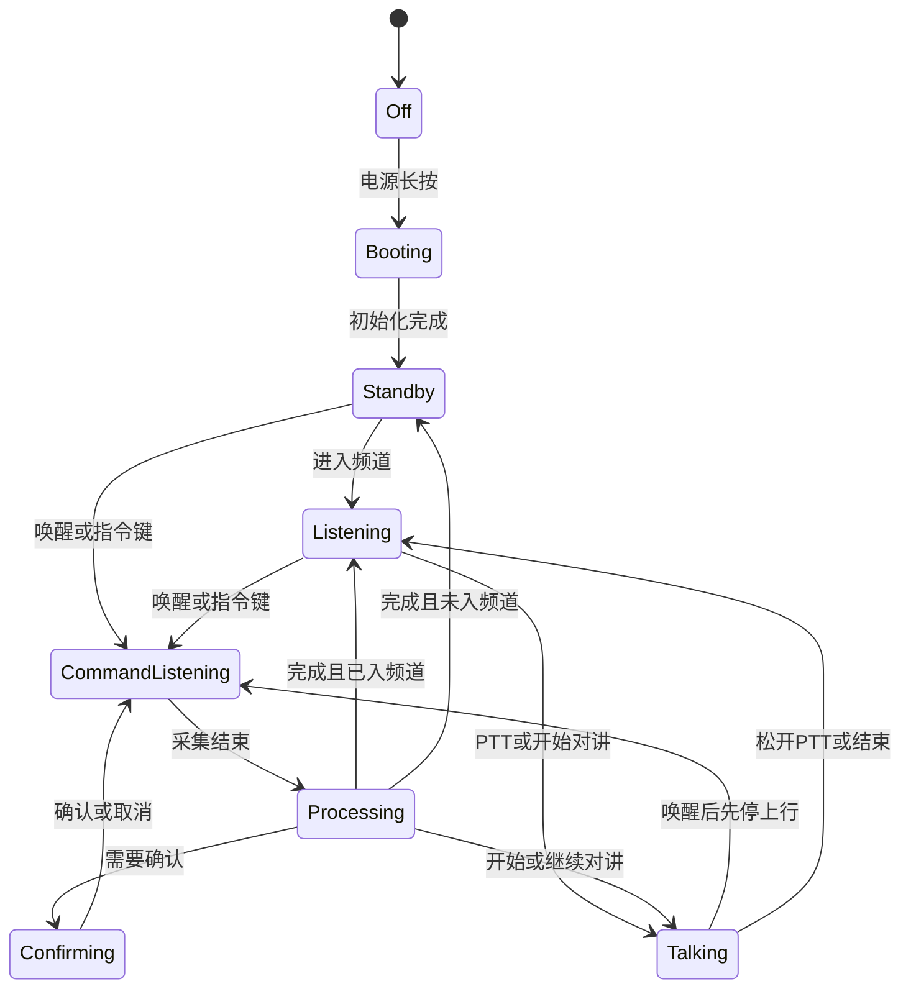
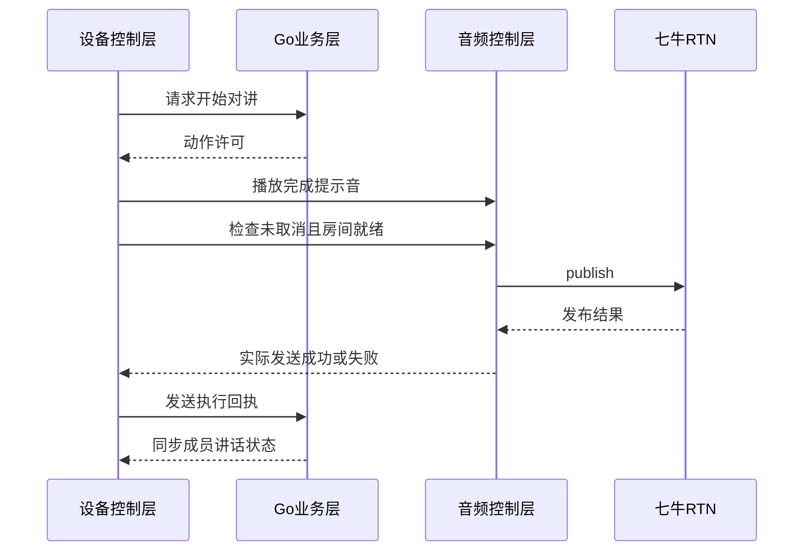

# fleet-ptt 详细技术方案：小路 3D 语音对讲机

本文定义小路智能对讲机的统一实现方案。浏览器中的 3D 对讲机是第一阶段交互载体，后续真实硬件沿用同一套业务语义、设备状态和服务协议。核心操作通过语音完成，只保留电源、指令/结束和 PTT 三个必要控件。

## 1. 目标与范围

| 项 | 方案 |
|----|------|
| 产品角色 | 小路；拟用唤醒词“你好小路” |
| 客户端 | React + Vite + Three.js 3D 设备原型 |
| 服务端 | Go HTTP API、WebSocket 设备信令、静态资源托管 |
| 对讲媒体 | 七牛实时音视频云 RTN，音频为主 |
| 指令能力 | 灵矽 ASR/TTS + Chat SSE 业务意图 |
| 存储 | SQLite，保存用户、设备、频道、成员和会话状态 |
| 部署 | Docker Compose，`make up` 一键启动 |
| 最终硬件 | 继承按键语义、屏幕状态、业务协议和音频路由 |

包含：昵称初始化、语音建群、口令确认入群、语音切群、上一频道、语音开始/结束对讲、PTT 兜底、成员状态、音量调整、口令播报、二维码展示和异常反馈。

不包含：开放域闲聊、地图、IM、支付、组织后台、全程 VOX 自动上麦、制造级 CAD、量产固件和续航结论。

## 2. 总体架构



| 模块 | 职责 |
|------|------|
| 3D 展示 | GLB 机身、按键命中、按压动画、相机和状态灯 |
| 设备屏幕 | 当前频道、状态、识别文字、确认、二维码和设备设置 |
| 设备控制层 | 统一处理语音、按键和屏幕动作，维护状态转换 |
| 音频控制层 | 唤醒、指令采集、TTS、RTN 收听/发布、音量和资源释放 |
| Go 业务层 | 用户、设备、频道、成员、口令、权限和动作执行 |
| 设备信令 | 定向设备动作、执行回执、成员广播和连接状态 |
| 灵矽接入 | 上游音频、ASR/TTS、意图文本和 Chat SSE |
| SQLite | 轻量持久化和单实例运行数据 |

3D 点击、语音和屏幕兜底都只调用设备控制动作，不直接访问 HTTP 或 SDK。业务层与音频层通过明确的请求、成功、失败和取消结果通信。

## 3. 设备形态与 3D 资产

设备采用短天线、竖屏、大侧键的车队对讲机形态，黑灰机身配橙色 PTT。概念尺寸约 125 × 58 × 32 mm，天线约 45 mm；尺寸用于交互比例，最终结构由器件和声学设计决定。

| 部件 | 位置与作用 |
|------|------------|
| 电源键 | 顶部，长按开关机 |
| 指令/结束键 | 侧面，唤醒、结束采集、取消或强制停机 |
| PTT | 侧面握持区，按住讲、松开停 |
| 屏幕 | 正面，显示业务状态与确认内容 |
| 状态灯 | 正面顶部，显示收听、指令、发送和异常 |
| 扬声器 | 正面下部，播放远端语音、TTS 和提示音 |
| 麦克风 | 正面或顶部，承担唤醒、指令和对讲采集 |
| 天线/背夹 | 补全设备形态，不增加业务操作 |

GLB 节点独立命名为机身、电源键、指令/结束键、PTT、屏幕和状态灯；按键轴心沿按压方向设置。初始目标为 3–5 万三角面、1K 为主的纹理、资源合计尽量不超过 5 MB。默认相机正面偏转约 15°，拖动背景可观察设备；操作按键不会旋转机身。手机端默认固定操作视角。

仓库内置 `web/public/models/xiaolu.glb`，节点使用 `body`、`power`、`command`、`ptt`、`screen`、`indicator`；天线、扬声器、麦克风孔和背夹为独立部件。模型来源为 `web/src/device/model.ts`，使用 Node 22 执行 `node --experimental-strip-types web/scripts/build-device-model.mjs` 可重新生成。

屏幕使用约 240 × 320 的逻辑布局。React/HTML 层与屏幕平面对齐，以保证中文输入、二维码和状态文字清晰；转到背面时隐藏屏幕层，避免穿透。页面外仅提供回正、缩放和观察辅助，不提供业务操作。

## 4. 三个控件的行为

| 控件 | 操作 | 行为 |
|------|------|------|
| 电源键 | 长按约 1.5 秒 | 开机或关机；关机释放唤醒、采集、播放、RTN、WebSocket、重连计时器和摄像头 |
| 指令/结束键 | 单击 | 唤醒小路；对讲中先停上行再进入指令；采集中结束采集 |
| 指令/结束键 | 长按 | 取消指令、停止播报并强制结束发送 |
| PTT | 按下并保持 | 当前频道就绪时请求发布音频；未入频道时播报先加入频道 |
| PTT | 松开、指针取消或窗口失焦 | 立即解除发送意图并停止发布 |

PTT、指令键和语音唤醒共用设备控制层。按键有按压位移、足够命中区、键盘操作和文字提示；短按与长按只触发一次。业务主路径不依赖触屏，屏幕输入和列表选择只作为语音失败时的兜底。

## 5. 语音交互

### 5.1 唤醒与连续说法

开机完成授权后，设备在收听频道或未入频道状态本地监听“你好小路”。支持连续说法，例如“你好小路，切到装货”；也支持先唤醒、听到应答后再说内容。补充参数和确认在同一轮上下文内无需重复唤醒。

本地唤醒不向云端持续上传完整待命音频，仅保留连续说法所需的短时内存数据。唤醒、静音、无输入和处理超时由设备控制层统一管理；浏览器后台和锁屏不作为常驻监听承诺。

### 5.2 业务指令

| 用户表达 | 设备行为 |
|----------|----------|
| 创建一个装货频道 | 创建并进入，逐位播报口令 |
| 加入口令三八四二 K 九 | 归一化口令、复述并等待确认 |
| 确认加入 / 取消 | 执行或清除待确认事项 |
| 进入装货频道 | 按频道名加入；同名时追问 |
| 切到卸货 / 切到第二个 | 停止上行并切换频道 |
| 回到上一个频道 | 返回上一次成功使用的频道 |
| 我有哪些频道 | 播报序号、名称和当前频道 |
| 开始对讲 / 继续对讲 | 完成提示音后持续发送 |
| 结束对讲 | 停止发送并恢复收听 |
| 音量小一点 / 调到百分之六十 | 调整本设备播放音量 |
| 谁正在讲话 | 播报当前频道的讲话成员 |
| 我的口令是什么 | 显示并逐位播报当前频道口令 |
| 显示邀请二维码 | 在屏幕显示当前频道二维码 |
| 把昵称改成张师傅 | 复述后确认并更新昵称 |

规则：口令为 6 位，字符集去掉易混字符 `0/O`、`1/I`；中文数字和分隔符归一化后校验。口令入群确认窗口为 2 分钟；无参数追问，同名或歧义澄清，过期或无待办的“确认”不得执行任何动作。昵称修改和口令加入需要确认，其余查询和音量操作不需要确认。

## 6. 音频路由与状态机

### 6.1 音频路由

- 收听状态：RTN 只订阅远端，本地唤醒可以运行。
- 指令状态：先阻断 RTN 上行，再采集指令并发送到灵矽；指令期间降低或暂停远端播放。
- 对讲状态：RTN 发布本地音频；普通对讲音频不送灵矽。
- TTS 状态：暂停唤醒触发和指令上传，避免自唤醒。
- 关机状态：销毁所有采集、播放、房间、信令和重连资源。

同一设备的指令上行和 RTN 上行互斥。需验证七牛 Web SDK 是否支持共享采集轨或外部音轨；不能假定两个 SDK 同时打开麦克风稳定。检测到唤醒词后先阻断 RTN 上行，再采集指令。首版接受检测完成前的唤醒词片段可能传给频道；检测后不得继续把指令音频送入频道。

### 6.2 状态机



实际发送必须以本地媒体发布成功为准；服务端动作许可、TTS 完成、媒体发布和成员状态广播分别产生结果。未入房、识别失败、网络断开、关机或取消时不得自动恢复发送。

### 6.3 对讲时序



停止顺序为：解除本地发送意图 → 阻断本地上行 → 同步业务状态。HTTP 请求不能阻塞本地停止。切群顺序为停止发送、提交频道切换、离开旧房间、进入新房间，目标媒体就绪后才播报“已切换”。

## 7. 身份、设备与数据

用户、应用设备和灵矽设备是三个独立概念。服务端保存经过授权的设备映射；设备 ID 用于定位，不作为凭证。

| 数据 | 作用 |
|------|------|
| users | 用户 ID、昵称、创建时间 |
| devices | 应用设备 ID、灵矽设备 ID、绑定状态、最后连接时间 |
| channels | 频道 ID、名称、口令、创建者、创建时间 |
| memberships | 用户、频道、角色 |
| device_session | 当前频道、发送状态、上一频道、活动动作 |
| command_context | 设备级待确认动作、参数、过期时间、动作 ID |

同一设备只允许一个当前频道和一个上行状态；成员事件广播给频道成员，设备动作定向到目标设备。绑定流程先验证设备归属，再建立用户会话。首次语音设置只允许初始化昵称和绑定，不开放未鉴权的通用音频代理。所有动作使用唯一动作 ID，处理重复回调、取消和迟到结果。

## 8. 服务接口

### 8.1 业务 HTTP

| 方法 | 路径 | 作用 |
|------|------|------|
| GET | `/healthz` | 进程探活 |
| POST | `/api/v1/device/session` | 创建或恢复设备会话 |
| POST | `/api/v1/device/bind` | 授权设备与用户绑定 |
| GET | `/api/v1/me` | 返回用户与当前频道 |
| GET/POST | `/api/v1/channels` | 查询或创建频道 |
| POST | `/api/v1/channels/join` | 按口令或名称入群 |
| POST | `/api/v1/channels/current` | 切换当前频道 |
| GET | `/api/v1/channels/{id}/rtn-token` | 为成员签发 RoomToken |
| POST | `/api/v1/actions/{id}/result` | 上报设备动作结果 |
| POST | `/api/v1/talk/start` | 请求开始上行 |
| POST | `/api/v1/talk/end` | 请求结束上行 |
| POST | `/api/v1/linx/chat` | 接收灵矽 Chat SSE 意图 |

### 浏览器设备注册

浏览器通过 `POST /api/v1/device/register` 获取服务端生成的设备 ID 和 256 位随机设备凭证，保存在本机。数据库只保存凭证 SHA-256 摘要。未绑定设备仅可凭该凭证向 `POST /api/v1/device/session` 提交昵称，绑定成功才签发业务会话；恢复时允许省略昵称，改昵称沿用相同用户 ID。设备 ID 本身没有认证能力，旧 `/api/v1/session` 入口也验证设备凭证。

已有浏览器使用有效 Bearer 会话调用注册接口迁移，保留用户、频道和成员关系；丢失设备凭证且没有有效会话时，不允许仅凭设备 ID 认领身份。当前浏览器原型保持用户与设备一对一，当前频道/上行状态沿用该用户的唯一会话记录。硬件预配另行实现。

灵矽 ID 只能通过服务端授权映射维护，浏览器注册及设置接口不接受灵矽 ID。回调只通过该映射查询设备，不以应用设备 ID 自动替代灵矽 ID。

### 8.2 设备 WebSocket

设备连接：`/api/v1/device/ws`。连接使用设备会话凭证，服务端从会话解析并绑定目标设备 ID；浏览器不能指定其他设备目标。动作包含 `action_id`，只发到该设备的活动连接。

服务端向设备发送：

```json
{ "type": "action", "action_id": "...", "action": "talk_start", "channel_id": "..." }
{ "type": "action", "action_id": "...", "action": "talk_end" }
{ "type": "action", "action_id": "...", "action": "switch_channel", "channel_id": "..." }
{ "type": "channel_state", "channel_id": "...", "name": "装货" }
{ "type": "members", "channel_id": "...", "members": [] }
{ "type": "action_cancel", "action_id": "..." }
{ "type": "error", "message": "..." }
```

设备向服务端发送：

```json
{ "type": "action_result", "action_id": "...", "success": true }
{ "type": "action_result", "action_id": "...", "success": false, "message": "..." }
{ "type": "talk_end" }
{ "type": "ping" }
```

`success` 必须为显式布尔值，失败信息使用 `message`。支持 `talk_start`、`talk_end`、`switch_channel`、`set_volume`、`show_join_qr`、`set_nickname`；`set_volume` 和 `set_nickname`通过字符串 `value` 传参，音量范围 0–100；`+10` / `-10` 表示相对当前设备音量增减 10 个百分点并限制在该范围内。每个设备最多一个待执行动作，服务端 15 秒超时后发送 `action_cancel`。客户端以 `action_id` 复用回执，不重复执行；断线取消本地待执行动作，重连只恢复频道和成员状态。

成员讲话状态只广播给同频道成员；设备动作只发送给目标设备。服务端不以 SSE 写入成功代替设备动作成功。

### 8.3 灵矽 Chat SSE

灵矽向 `/api/v1/linx/chat` 发送 `auth.device_id`、`details.msg` 和 `details.session_id`，请求头为 `Authorization: Bearer <LINX_CHAT_TOKEN>`。服务端验证设备映射、解析意图、检查权限并执行动作，返回一条 `message` 和一条 `message_end`；`details.answer` 用于 TTS，`details.intent` 表示动作类型，`session_id` 原样回传。

意图包括 `create_channel`、`join_channel`、`confirm_join`、`cancel_join`、`switch_channel`、`previous_channel`、`talk_start`、`talk_end`、`list_my_channels`、`list_speakers`、`show_join_code`、`show_join_qr`、`set_volume` 和 `set_nickname`。业务失败也返回可播报的 `answer`，设备动作以 WebSocket 回执确认。

### 8.4 灵矽音频接入

优先使用官方 Web 接入；若设备协议需要浏览器无法设置的握手头，则由服务端建立受鉴权的音频桥接。桥接负责设备注册、握手、音频编码、ASR/TTS 音频转发、会话释放和断线处理；灵矽凭证只存服务端。必须实测上行格式、采样率、帧长、TTS 格式、播放完成信号和并发限制，不能假设浏览器 `MediaRecorder` 输出可直接使用。

## 9. 安全、部署与运行约束

- `SESSION_SECRET`、七牛 AK/SK、RTN AppID、`LINX_CHAT_TOKEN` 和桥接凭证只放本地 `.env` 或部署环境。
- RoomToken 由 Go 短时签发，浏览器不接触七牛 SecretKey。
- 灵矽回调校验 Bearer token、设备映射、请求类型、会话 ID 和动作权限。
- WebSocket 仅接受有效设备会话，动作按设备定向；频道成员事件按成员关系发送。
- SQLite 使用单实例 volume，数据需要备份；多实例部署需另行提供共享存储和连接协调。
- 公网使用 HTTPS，反向代理支持 WebSocket 升级和 SSE 不缓冲；`localhost` 可用于浏览器麦克风开发。
- 关机、取消、失焦和断线均释放本地资源；恢复连接后重新同步频道，不自动恢复讲话。

## 10. 实施与验收

1. 设备控制层、三按键灰模、屏幕状态和资源生命周期。
2. 频道、成员、RTN 收听与 PTT 对讲闭环。
3. 灵矽音频桥接、Chat 意图、动作 ID、回执、确认与取消。
4. “你好小路”本地唤醒、连续说法、对讲中打断和回声处理。
5. 正式模型、材质、灯光、二维码和移动端体验。
6. 目标硬件平台的 RTN、灵矽、唤醒、声学、弱网和续航评估。

验收要求：首次授权后，用户只通过小路语音完成昵称设置、建群、确认入群、切群/回切、开始/结束对讲、音量和邀请查询；三个按键随时可以中止或兜底。验证覆盖无效口令、确认过期、歧义追问、识别失败、媒体失败、快速松开、迟到回调、重复动作、设备断线、关机释放和真实双端音频。

## 11. 配置与开发命令

| 配置 | 用途 |
|------|------|
| `HTTP_ADDR` | Go 监听地址，默认 `:8080` |
| `STATIC_DIR` | 静态目录，默认 `web/dist` |
| `SQLITE_PATH` | SQLite 文件路径 |
| `SESSION_SECRET` | 设备/用户会话签名 |
| `QINIU_ACCESS_KEY` / `QINIU_SECRET_KEY` / `QINIU_RTN_APP_ID` | 七牛 RTN 凭证 |
| `LINX_CHAT_TOKEN` | 灵矽 Chat 回调校验 |
| `PUBLIC_BASE_URL` | 灵矽访问本服务的公网基址 |

`make up` 构建并启动 Docker Compose；`make server` 启动 Go；`make web` 启动 Vite；`make health` 请求 `/healthz`；`make down` 停止服务。真实配置不入 Git。
