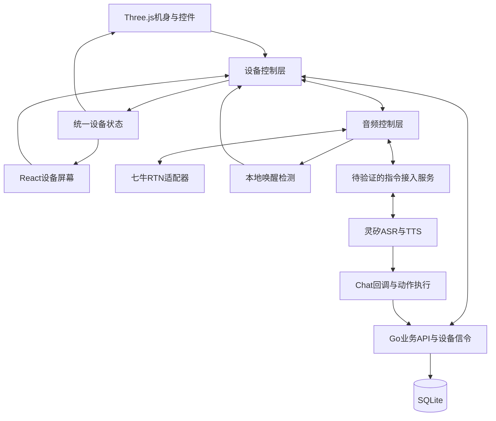
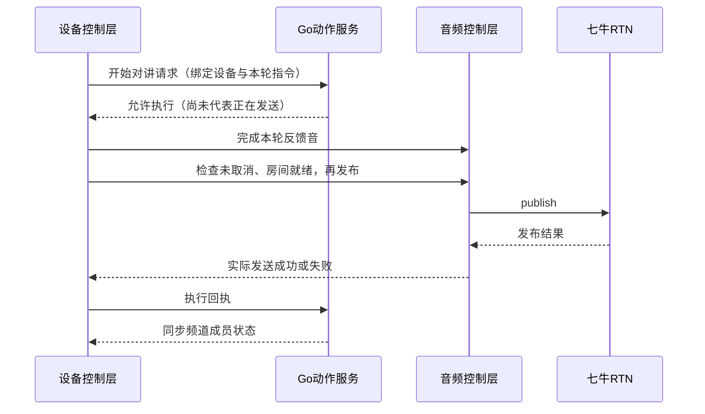

# fleet-ptt 详细技术方案：小路 3D 语音对讲机

本文以 [产品方案](./product-design.md) 为目标，说明现有实现如何演进。代码核对基线为 `eb078c0`（2026-10-23）；本次仅修改文档，没有实现下述迁移，也没有验证外部平台链路。

## 1. 目标与实现边界

交付浏览器内可操作、可实际通话的小路 3D 对讲机。核心业务通过语音完成；仅保留电源、指令/结束和 PTT 三个控件。最终硬件继承操作语义和业务协议，不必运行 3D 场景。

| 分类 | 内容 |
|------|------|
| 继续复用 | Go HTTP 服务、SQLite 用户/频道/成员、频道业务校验、RoomToken 签发、七牛 RTN 传输、二维码编解码 |
| 必须调整 | 页面内业务编排、音频生命周期、讲话状态语义、设备身份与信令路由、指令上下文与结果反馈 |
| 必须新增 | 3D 展示、开关机控制、原型内指令音频、本地唤醒、语音首次设置、设备本地动作 |
| 不再作为目标 | 外部灵矽指令页、页面外业务表单、依赖点选的主路径、用数据库状态代替媒体成功 |
| 待验证 | 灵矽浏览器接入或桥接协议、七牛采集轨复用、本地唤醒引擎、目标硬件 SDK 支持 |

保留现有代码作为迁移基础，不因新方案批量删除。新接口、表结构与音频适配方案在协议验证后形成实现规格；不能把本文件中的目标行为当成现有接口已经支持。

## 2. 目标架构与模块责任

| 模块 | 目标职责 | 现有入口 |
|------|----------|----------|
| 3D 展示 | 模型、材质、相机、按钮命中与动画 | 新增 |
| 设备屏幕 | 状态、识别文字、确认与设备内兜底输入 | 提取 `pages/` 中可复用 UI |
| 设备控制 | 电源、PTT、指令、切群与状态转换 | 提取 `App`、`ChannelPage`、`TalkPanel` 编排 |
| 音频控制 | 采集归属、唤醒、指令/PTT 路由、音量与播报 | 扩展 `rtc/`；`linx/` 当前为空占位 |
| 业务 API | 会话、频道、成员与权限校验 | `server/internal/api`、`channel`、`store` |
| 设备信令 | 定向动作、回执、频道状态与断线反馈 | 调整 `ws/` 和前端 `signaling/` |
| 指令执行 | 身份定位、意图解析、确认、取消与结果 | 调整 `linxchat/` 和 `api/linx*` |

3D 点击只调用控制动作，不直接调用 HTTP 或七牛 SDK。语音、实体按钮和屏幕兜底共享同一执行路径。无需预先新增通用插件框架或复制现有频道服务。

## 3. 3D 资产与设备屏幕

建议使用 Three.js + GLB，React/HTML 渲染与屏幕平面对齐的 UI；本次不安装依赖。先做几何灰模与命中区，再制作正式外观。

| 项 | 设计约定 |
|----|----------|
| 独立模型节点 | 机身、电源键、指令/结束键、PTT、屏幕、状态灯 |
| 轴心 | 按键沿按压方向运动，统一单位与坐标方向 |
| 初始资源预算 | 3–5 万三角面、1K 为主纹理、合计尽量不超过 5 MB；按目标手机实测调整 |
| 默认视角 | 正面偏转约 15°，显示屏幕和侧键；手机默认固定操作视角 |
| 观察操作 | 拖动背景旋转，操作按键不旋转；页面外只放回正、缩放等辅助 |
| 屏幕 | 约 240 × 320 逻辑布局，中文输入和二维码保留清晰度 |
| 遮挡 | 背面视角隐藏 HTML，避免穿透；正确处理屏幕和机身命中顺序 |
| 可访问性 | 名称、键盘操作、足够命中区、文字与颜色共同提示 |
| 渲染 | 不默认使用重型后处理；静止且无动画时减少重绘 |

所有业务页面嵌入设备屏幕。扫码复用宿主摄像头，但现有 `BarcodeDetector` 不受所有浏览器支持，应保留系统相机扫码/口令路径；不推断未来真机一定带摄像头。

## 4. 设备状态与媒体时序

### 4.1 状态归属

- 电源/连接：关机、启动、在线、断线。
- 业务音频：未入房、收听、请求发送、实际发送、指令采集、处理、待确认、播报。
- 屏幕导航：主页、列表、邀请、设置等；导航不拥有麦克风生命周期。

当前 `TalkPhase` 只有 `out/in_channel/talking`，`commanding` 是布尔值；新状态不能直接沿用其“收到动作即开始讲话”的含义。设备控制层统一决定状态；本地媒体结果用于本机显示，客户端回执用于服务端与其他成员状态。

### 4.2 开始对讲：请求、反馈、发布分开

这是目标逻辑，不是当前线协议。现有 `talk_start` 同时承担“命令本机开麦”和“广播已讲话”，应拆分语义；具体事件名与字段在实现规格中确定。收到许可后被取消、关机或切群，不得继续发布。

PTT 采用同一媒体控制路径，但不要求每次播放完整 TTS。提示音不能进入频道上行；实际发布成功前只显示“准备发送”。

### 4.3 停止与唤醒

停止顺序必须为：解除本地发送意图 → 阻断本地上行 → 同步服务端状态，不依赖 HTTP 返回。当前 `TalkPanel.stopLocal` 的等待顺序不符合目标。

检测到“你好小路”时，先阻断 RTN 上行再转送指令。已有 SDK 调用可能仍在队列中，因此需验证本地音轨静音/路由关闭能否即时阻断发送；仅排队 `unpublish` 不构成时序保证。

PTT 松开、指针取消、窗口失焦、长按强制结束均使用这条路径。SDK 开麦完成后仍检查发送意图。关机还要关闭唤醒、采集、TTS、房间、信令、重连计时器及摄像头；重新开机默认收听，不恢复发送。

### 4.4 切群与结果一致性

1. 本地停止发送并记录当前房间。
2. 执行频道业务变更，退出旧媒体房间，加入目标房间。
3. 目标媒体就绪后显示“可收听”，再反馈完整成功。
4. 业务成功但进房失败：说明“已选择频道，但连接失败”，提供重试，不播报“已可收听”。

“上一频道”只在媒体切换成功后更新；失败不能覆盖成功历史。是否回滚服务端当前频道需在实现规格中统一，不能前后端各自静默回滚。

### 4.5 断线与取消

信令或媒体断开都必须通知控制层，先停止发送，恢复后重新读取频道与成员。现有信令自动重连仅重建 WebSocket，没有将连接状态上报给 `TalkPanel`；服务端清除 talking 也不会自动切断仍存活的 RTN 上行。

指令要关联设备连接、本轮动作及执行结果。取消必须在业务执行边界判定：尚未提交的动作不得执行；已经创建的频道或已提交的成员关系不能因迟到回执被当作“已撤销”。此时停止后续媒体动作并重新同步、说明实际结果。对于建群等非幂等动作，还要处理同轮回调重复投递，不能把灵矽 `session_id` 未经验证就当作唯一动作 ID。

## 5. 语音链路、采集与身份

### 5.1 接入路径验证

现有基线为外部灵矽设备采集 → Chat SSE 回调 → Go → H5 信令，并非原型内语音闭环。协议核对历史见 [灵矽接入记录](./linx-access.md)。

优先核实官方 Web 接入；若不适用，验证浏览器音频 → 本服务 WebSocket → 灵矽设备连接的桥接。设备注册、授权、握手、上行格式、采样率、帧长、结束采集标志、TTS 格式和播放完成信号、并发限制都要实测。

浏览器不能设置灵矽设备协议要求的自定义握手头；不假设 `MediaRecorder` 默认编码可直接传输。根据平台支持选择 AudioWorklet PCM 或匹配的编码方案。实时 ASR 文本是否可取也需验证；没有时只展示采集状态和最终文本。

### 5.2 采集源与播放

当前七牛封装自行创建麦克风，`stopPublish` 保留音轨、`leave` 销毁音轨，没有共享采集、音量和 TTS 控制接口。

目标由设备音频控制层管理采集：本地唤醒可在收听与对讲中运行，指令上行与 RTN 上行互斥。先验证七牛 Web SDK 是否允许共享采集轨或外部音轨，不能假定多个 SDK 同时打开麦克风稳定。

- 待命音频不持续上传，只保留连续说法所需的短时内存数据，不持久化录音。
- TTS 期间暂停唤醒触发和指令上传，指令期间降低/暂停远端播放，结束后恢复。
- 本地音量作用于本设备播放，不修改输入增益或其他设备；远端声音、TTS、提示音应使用统一音量策略。
- 关机销毁所有采集；仅结束对讲时保留本地唤醒所需采集。
- 浏览器音频播放可能需要用户手势；启动时处理解锁，无法解锁时明确提示，不能承诺首次授权后所有浏览器绝无额外手势。

首版接受检测完成前的唤醒词片段可能发送给频道。对讲中后续指令隔离、远端回声误触发和 TTS 自唤醒必须实测。

### 5.3 唤醒与对话上下文

角色名“小路”，拟用唤醒词“你好小路”。引擎需验证自定义词、浏览器运行、授权、资源消耗、噪声和口音；真机低功耗常驻另验，不承诺浏览器后台或锁屏监听。

同轮补充参数、确认不重复唤醒；采集超时与业务确认 TTL 分开。现有 `JoinGate` 只是按用户保存口令，不能承担昵称确认、参数追问或取消所有操作。目标上下文限定当前设备与动作，保留两分钟口令确认上限，清晰处理取消、过期、无关新指令和重复确认。

### 5.4 身份、初始化与路由

应用设备 UUID 与灵矽设备 ID 分离，服务端建立经授权映射。现有 `users.device_id` 与用户一对一，`user_session` 按用户记录当前频道，WS 按用户广播给全部连接；不能只增加一个映射表就声称已支持独立多设备。

实现规格需明确用户、设备、活动连接、当前频道和确认状态的归属。至少保证语音控制只到目标连接，频道成员事件仍可广播；不直接把“给用户发消息”当作“给设备下命令”。设备 ID 只用于定位，绑定要验证归属，不能作为凭证。

语音首次设置发生在正常昵称会话之前。应先建立受限、经过验证的设备上下文，仅允许昵称初始化与绑定，成功后建立用户会话。现有公开 `POST /session` 不能直接充当硬件认证方案；未定义注册流程前不开放通用语音代理。

桥接在服务端保管灵矽凭证、只访问已配置端点；浏览器不能指定任意身份或转发目标。数据库迁移需保留原用户、频道和成员数据，另行确定映射/会话结构及回退方式，本次不执行迁移。

## 6. 动作执行与现有实现改造清单

以下均为代码静态核对结果，不代表已复现运行故障。链接对应现有实现入口；改动时需同步维护相关测试，而不是只把旧断言原样搬进 3D 页面。

| 领域 / 代码入口 | 当前行为 | 新方案要求与处理方式 | 关键验证 |
|-----------------|----------|----------------------|----------|
| [App](../web/src/App.tsx)、[ChannelPage](../web/src/pages/ChannelPage.tsx) | 登录后直接进入表单页；业务和媒体由页面生命周期触发 | 提取设备控制层；开关机显式控制连接，屏幕是状态投影 | 黑屏时不后台自动进房；开关机资源释放 |
| [设备身份](../web/src/state/device.ts)、[用户服务](../server/internal/user/user.go) | UUID 本地生成，昵称入口必填；同 device upsert 用户 | 增加受限初始化与授权绑定，保留已有用户数据 | 首次语音昵称；绑定归属；改昵称不变用户 |
| [WS Hub](../server/internal/ws/hub.go)、[存储](../server/internal/store/store.go) | 连接、当前频道和 talking 按用户组织 | 区分设备控制与成员广播；确认设备状态归属 | 同用户多个连接不同时被开麦，断线归属正确 |
| [TalkPanel](../web/src/pages/TalkPanel.tsx) | UI 提前置 talking；`startTalk` 后才发布；停止先等待 HTTP | 分离意图与媒体状态；本地停止优先，媒体成功后回执 | HTTP 卡住仍能停止；发布失败不显示发送 |
| [信令客户端](../web/src/signaling/index.ts) | `talk_start` 兼任命令/状态，计数抑制本机回声；断线只重连 | 关联动作与设备，分离媒体结果；连接状态进入控制层 | 迟到/重复事件不重新开麦，信令断开停止上行 |
| [RTC 房间](../web/src/rtc/room.ts)、[七牛适配](../web/src/rtc/qiniu.ts) | SDK 自建麦克风，串行媒体调用，无音量/播报控制 | 验证共享采集与即时阻断；补播放控制，保留进房订阅封装 | 对讲中唤醒、按下即松开、TTS/指令不串入频道 |
| [指令状态](../web/src/state/command.ts)、[LinX 占位](../web/src/linx/index.ts) | 仅切换 commanding；不采集音频 | 新增采集、处理、确认、播报、取消和超时 | 原型内完整 ASR/TTS，按钮和唤醒同路径 |
| [语音动作](../server/internal/api/linx_action.go) | 回调直接改业务并回成功文案，非 start 意图均 EndTalk | 媒体先在本地停止；业务结果与媒体/本地动作回执区分 | 切群进房失败不误播成功；已停止后“结束”给一致反馈 |
| [Chat 回调](../server/internal/api/linx.go) | 同设备字符串查用户；`session_id` 只回传；无动作取消/去重 | 验证设备映射与有效指令，协调重复回调和提交边界 | 取消前后、同轮重复建群、设备不匹配 |
| [意图解析](../server/internal/linxchat/intent.go) | 关键词解析、ASCII 口令，未知话术 echo | 补中文数字、唤醒前缀处理、新动作与未识别反馈 | “你好小路，…”正确抽槽；不误报执行成功 |
| [确认门](../server/internal/linxchat/confirm.go) | 按用户保存单个口令，支持两分钟确认 | 扩展设备内待办上下文，昵称/补充参数独立 | “确认/取消”只处理本设备有效待办 |
| [状态展示](../web/src/state/presence.ts) | 提示去灵矽设备；成员 live 可由服务端 talking 决定 | 更新为原型内文案，成员数和在线/媒体状态区分 | 无外部指令页依赖，无假电量或在线数 |
| [二维码](../web/src/pages/JoinQR.tsx)、[扫码](../web/src/pages/ScanJoin.tsx) | 页面上生成与扫描，扫描依赖 BarcodeDetector | 复用逻辑，嵌入设备屏幕，补语音显示入口 | 不支持扫描时仍能口令加入，关机关闭相机 |

### 6.1 能力复用范围

建群、口令/名称入群、成员关系和 RoomToken 校验可复用业务层；“复用”不意味着原 UI、信令时序或成功反馈不变。RoomToken 继续由 Go 签发，七牛密钥不交浏览器。

新增上一频道、音量、讲话成员查询、口令/二维码展示和昵称确认。设备本地动作必须送达目标设备并有执行结果，不能只在 SSE 中返回一句“已调整”。服务端查询可直接回答，但必须按当前频道与会话校验。

先扩展现有规则；若需要更自由表达，再评估受约束的模型意图解析。模型只能选择支持的动作与参数，权限与执行由业务层负责。同名频道澄清与缺参追问需要真实上下文，现有报错/提示文本不等同于多轮对话已经实现。

### 6.2 保留的业务边界

同一设备只收听/发送一个当前频道；允许多个成员同时发送，不增加抢麦机制。口令沿用 6 位去混淆字符集。无明确需求不增加组织后台、录音、地图或全域聊天。

## 7. 现有协议与数据快照（供迁移对照）

本节仅描述核对基线，不能作为新原型的最终线协议。协议变更时同步前端、Go 和测试，逐条标明新增/替换字段；不要为尚未存在的外部客户端预先增加兼容分支。

### 7.1 现有 HTTP 与 WS

| 方法 | 路径 | 当前用途 |
|------|------|----------|
| GET | `/healthz` | 固定返回 OK，只是进程探活 |
| POST | `/api/v1/session` | nickname + device_id，创建会话 |
| GET | `/api/v1/me` | 用户与当前频道 |
| GET / POST | `/api/v1/channels` | 已加入列表 / 创建频道 |
| POST | `/api/v1/channels/join` | 按 code 或 name 加入 |
| POST | `/api/v1/channels/current` | 选择当前频道 |
| GET | `/api/v1/channels/{id}/rtn-token` | 成员校验后签发 RoomToken |
| POST | `/api/v1/talk/start`、`/api/v1/talk/end` | 修改 talking 并广播 |
| GET | `/api/v1/ws` | WebSocket，支持会话 token 查询参数或 Bearer |
| POST | `/api/v1/linx/chat` | 使用独立 LINX_CHAT_TOKEN 校验的 Chat SSE 回调 |

现有 WS 服务端事件为 `talk_start`、`talk_end`、`members`、`channel_created`、`channel_switched`、`notice`、`error`、`pong`；客户端消息为 `talk_end`、`ping`。没有设备定向动作 ID、执行回执或指令取消协议。

现有 SSE 按 `data: <JSON>\n\n` 输出，JSON 内 `event` 为 `message` 或 `message_end`，不是单独的 SSE `event:` 行。`message` 包含 `type: chat`、`session_id` 与 `details.answer/intent`；没有浏览器可直接消费的音频。`Accept: text/event-stream` 是调用约定，当前处理器未校验该请求头。

### 7.2 现有持久化与内存状态

| 位置 | 当前内容 | 迁移注意 |
|------|----------|----------|
| SQLite users | id、display_name、唯一 device_id、created_at | 不混同硬件/灵矽身份 |
| SQLite channels | id、name、唯一 join_code、created_by、created_at | 保留已有频道与口令 |
| SQLite memberships | user_id + channel_id 主键、role | 保留成员授权 |
| SQLite user_session | user_id 主键、current_channel_id、talking | talking 是持久化标记，不是真实媒体事实 |
| 内存 JoinGate | 按用户的待确认口令与过期时间 | 重启丢失；目标需设备/动作隔离 |
| 内存 WS Hub | 按用户的连接集合 | 不能单独作为硬件定向控制模型 |
| localStorage | 应用设备 UUID、会话 | 没有跨平台硬件身份绑定或生产认证 |

服务端 session_token 是无过期的 HMAC-SHA256 令牌；RoomToken 为一小时有效、permission=user，房间与用户由服务端固定。现有 SQLite 使用单连接；维持单实例部署，不凭此设计推断已支持多实例。

## 8. 配置与部署事实

| 配置 | 当前含义 |
|------|----------|
| HTTP_ADDR | 监听地址，默认 `:8080` |
| STATIC_DIR | Go 静态目录，默认 `web/dist` |
| SQLITE_PATH | Go 默认 `data/fleet-ptt.db`；样例为容器路径 `/data/fleet-ptt.db` |
| SESSION_SECRET | 会话签名，未设置时昵称进入失败 |
| QINIU_ACCESS_KEY / QINIU_SECRET_KEY / QINIU_RTN_APP_ID | 签发 RTN 凭证；占位符不代表可真实进房 |
| LINX_CHAT_TOKEN | 回调校验，留空拒绝；不是灵矽设备上游访问凭证 |
| PUBLIC_BASE_URL | 当前仅用于输出安全处理后的回调地址日志，不配置平台、不建立桥接 |

真实配置只放本地 `.env` 或部署环境。当前没有唤醒引擎、音频桥接和设备注册配置，验证方案前不新增占位变量误导可用性。

- `make up` 调用 Compose，读取 `.env`，构建 React 和 Go 后由 Go 托管；端口 `8080:8080`，`./data:/data`。
- `make server` 不读取 `.env`，本地运行需显式设置所需环境变量；不要把样例容器数据库路径直接当本地路径。
- `make web` 安装依赖后运行 Vite，代理 `/api`（含 WS）和 `/healthz`；`VITE_DEV_API` 可覆盖默认目标。
- `make health` 的 OK 不校验数据库操作、七牛配置、灵矽绑定、麦克风或媒体可用性。
- 当前 Compose 没有 Caddy 或 `tls` profile。公网/局域网非 localhost 的麦克风与摄像头测试需配置 HTTPS；反向代理要支持 WS 升级和 SSE 不缓冲。
- 容器依赖宿主时钟同步，不存在容器内 NTP 配置。SQLite 数据需备份，硬件/映射迁移另定方案。

## 9. 实施顺序与验证

| 阶段 | 工作 | 验收与依赖 |
|------|------|------------|
| 0. 能力验证 | 灵矽接入、采集共享、唤醒引擎、设备注册 | 产出真实握手/音频/资源测量结果，形成接口与数据迁移规格 |
| 1. 控制层与灰模 | 三按键、设备屏幕、开关机、媒体状态分离 | 可复用现有业务手动通话；可与阶段 0 独立推进 |
| 2. 原型内语音 | 身份路由、采集/TTS、动作回执、确认取消 | 无外部灵矽页面，按键唤醒完成真实业务 |
| 3. 本地唤醒 | 连续说法、对讲中打断、播报协调 | “你好小路”完成免手动流程，噪声/回声实测 |
| 4. 外观与硬件衔接 | 正式模型与性能、目标硬件 SDK 评估 | 不把网页后台表现当作真机续航或常驻能力 |

针对性测试按改动选择：设备控制状态、发布失败、HTTP 挂起时停止、快速 PTT、迟到/重复回调、取消提交边界、设备定向、中文口令、确认和数据迁移。复用既有频道/Token/二维码测试；现有只验证工具函数的测试不替代控制层集成测试。

人工或经授权的浏览器验证覆盖 3D 命中与遮挡、音频解锁、两独立客户端实际通话、灵矽 ASR/TTS、对讲中唤醒、TTS 和远端回声、真实断线。记录环境、输入、实际结果和限制；没有实测不宣称闭环完成。

文档修改只检查格式、链接和一致性，不运行业务测试。开发提交默认只跑相关测试；发布分支不主动检查或等待远端 CI。

## 10. 实现前仍需定案的事项

1. 灵矽官方 Web 接入或服务端桥接的实测结论，设备注册/上游凭证来源。
2. 应用设备与用户关系、活动连接控制权、频道与确认状态作用域，以及数据迁移方式。
3. 请求/实际媒体状态、回执、取消和重复回调的字段与执行边界。
4. 共享采集与即时阻断的 SDK 能力、本地唤醒引擎及监听/超时参数。
5. 真实硬件平台与七牛、灵矽、唤醒 SDK 支持；声学、续航、弱网和结构需独立真机验证。

这些是开发前需要评审的具体选择，不妨碍先做灰模与现有控制逻辑提取；不能默认为已确认架构或直接改动接口、数据库。
