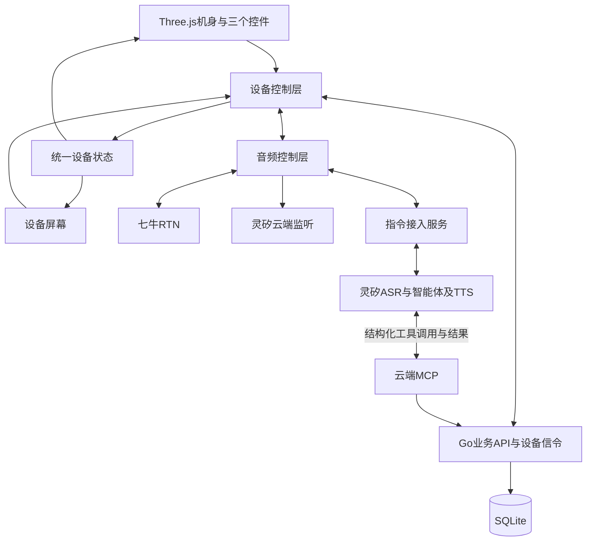
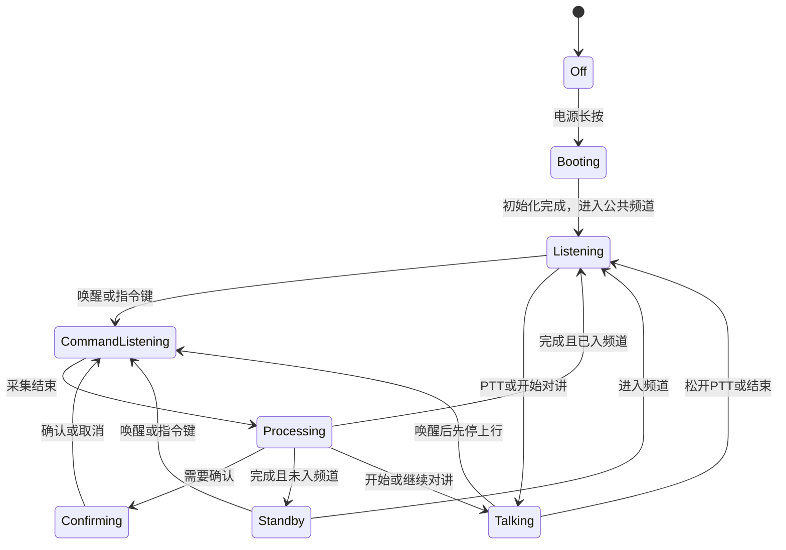
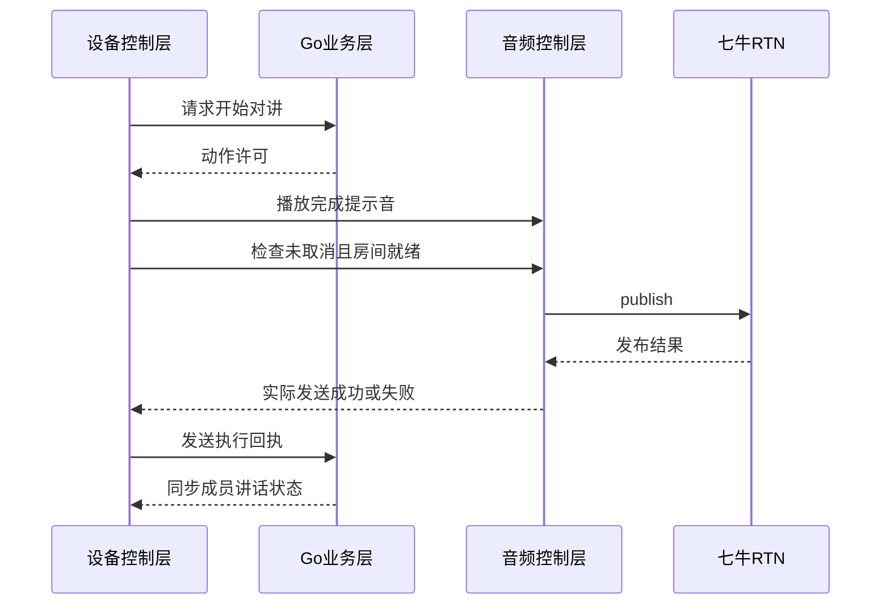

# fleet-ptt 详细技术方案：小路 3D 语音对讲机

本文定义小路智能对讲机的统一实现方案。浏览器中的 3D 对讲机是第一阶段交互载体，后续真实硬件沿用同一套业务语义、设备状态和服务协议。核心操作通过语音完成，只保留电源、指令/结束和 PTT 三个必要控件。

## 1. 目标与范围

| 项 | 方案 |
|----|------|
| 产品角色 | 小路；唤醒词“你好小路” |
| 客户端 | React + Vite + Three.js 3D 设备原型 |
| 服务端 | Go HTTP API、WebSocket 设备信令、静态资源托管 |
| 对讲媒体 | 七牛实时音视频云 RTN，音频为主 |
| 指令能力 | 灵矽 ASR/智能体/TTS + 云端 MCP 业务工具 |
| 存储 | SQLite，保存用户、设备、频道、成员和会话状态 |
| 部署 | Docker Compose，`make up` 一键启动 |
| 最终硬件 | 继承按键语义、屏幕状态、业务协议和音频路由 |

包含：昵称初始化、开机自动收听公共频道、跨频道在线联系人、语音建频道并定向邀请、接受/拒绝邀请、语音建群、口令确认入群、语音切群、上一频道、语音开始/结束对讲、PTT 兜底、成员状态、音量调整、口令播报、二维码展示和异常反馈。

不包含：开放域闲聊、地图、IM、支付、组织后台、全程 VOX 自动上麦、制造级 CAD、量产固件和续航结论。

## 2. 总体架构



| 模块 | 职责 |
|------|------|
| 3D 展示 | GLB 机身、按键命中、按压动画、相机和状态灯 |
| 设备屏幕 | 当前频道、状态、识别文字、确认、二维码和设备设置 |
| 设备控制层 | 统一处理语音、按键和屏幕动作，维护状态转换 |
| 音频控制层 | 唤醒、指令采集、TTS、RTN 收听/发布、音量和资源释放 |
| Go 业务层 | 用户、设备、频道、成员、口令、权限和动作执行 |
| 设备信令 | 定向设备动作、执行回执、成员广播和连接状态 |
| 灵矽接入 | 上游音频、ASR/TTS、智能体语义理解和云端 MCP 工具调用 |
| SQLite | 轻量持久化和单实例运行数据 |

3D 点击、语音和屏幕兜底都只调用设备控制动作，不直接访问 HTTP 或 SDK。业务层与音频层通过明确的请求、成功、失败和取消结果通信。

## 3. 设备形态与 3D 资产

设备采用短天线、竖屏、大侧键的车队对讲机形态，黑灰机身配橙色 PTT。概念尺寸约 125 × 58 × 32 mm，天线约 45 mm；尺寸用于交互比例，最终结构由器件和声学设计决定。

| 部件 | 位置与作用 |
|------|------------|
| 电源键 | 顶部，长按开关机 |
| 指令/结束键 | 侧面，唤醒、结束采集、取消或强制停机 |
| PTT | 侧面握持区，按住讲、松开停 |
| 屏幕 | 正面，显示业务状态与确认内容 |
| 状态灯 | 正面顶部，显示收听、指令、发送和异常 |
| 扬声器 | 正面下部，播放远端语音、TTS 和提示音 |
| 麦克风 | 正面或顶部，承担唤醒、指令和对讲采集 |
| 天线/背夹 | 补全设备形态，不增加业务操作 |

GLB 节点独立命名为机身、电源键、指令/结束键、PTT、屏幕和状态灯；按键轴心沿按压方向设置。初始目标为 3–5 万三角面、1K 为主的纹理、资源合计尽量不超过 5 MB。默认相机正面偏转约 15°，拖动背景可观察设备；操作按键不会旋转机身。手机端默认固定操作视角。

仓库内置 `web/public/models/xiaolu.glb`，节点使用 `body`、`power`、`command`、`ptt`、`screen`、`indicator`；天线、扬声器、麦克风孔和背夹为独立部件。模型来源为 `web/src/device/model.ts`，使用 Node 22 执行 `node --experimental-strip-types web/scripts/build-device-model.mjs` 可重新生成。

屏幕使用约 240 × 320 的逻辑布局。React/HTML 层与屏幕平面对齐，以保证中文输入、二维码和状态文字清晰；转到背面时隐藏屏幕层，避免穿透。页面外仅提供回正、缩放和观察辅助，不提供业务操作。

## 4. 三个控件的行为

| 控件 | 操作 | 行为 |
|------|------|------|
| 电源键 | 长按约 1.5 秒 | 开机或关机；关机释放唤醒、采集、播放、RTN、WebSocket、重连计时器和摄像头 |
| 指令/结束键 | 单击 | 唤醒小路；对讲中先停上行再进入指令；采集中结束采集 |
| 指令/结束键 | 长按 | 取消指令、停止播报并强制结束发送 |
| PTT | 按下并保持 | 当前频道就绪时请求发布音频；未入频道时播报先加入频道 |
| PTT | 松开、指针取消或窗口失焦 | 立即解除发送意图并停止发布 |

PTT、指令键和语音唤醒共用设备控制层。按键有按压位移、足够命中区、键盘操作和文字提示；短按与长按只触发一次。业务主路径不依赖触屏，屏幕输入和列表选择只作为语音失败时的兜底。

## 5. 语音交互

### 5.1 唤醒与连续说法

开机、完成文本昵称设置和麦克风授权后，设备在前台持续通过灵矽 WebSocket 的 realtime 模式上传音频。服务端以灵矽 STT 文本开头的“你好小路”作为唤醒条件，允许“小鹿”“小陆”两个同音转写，不接受“小度”；不加载本地唤醒模型。整句“你好小路，切到装货”仍由灵矽智能体理解，不丢弃唤醒词后的内容。指令键可手动触发同一流程。

未唤醒时服务端拒绝业务工具并过滤 TTS。唤醒后通知设备先停止 RTN 上行，等待匹配本轮标识的回执后开放工具与播报。播放实际结束后保留 20 秒补充参数/确认窗口；成功开始对讲后直接回到唤醒待命，普通讲话不进入指令窗口；超时需重新唤醒。单轮处理限时 30 秒，播报保护上限 60 秒。页面隐藏时暂停，回到前台后恢复；关机或断线释放采集与播放资源。

这是基于云端 STT 的唤醒门控，灵矽的 auto 模式和 listen.detect 均不表示云端自动识别自定义唤醒词。待命及对讲音频也会上传给灵矽，未开放业务工具不代表没有 ASR/模型消耗。官方 STT 和 MCP 没有共同的逐句请求标识；本地轮次标识只用于设备确认，不能证明迟到的 MCP 调用属于哪一句话。过期窗口拒绝调用，但新窗口内迟到请求的归属仍需平台能力与真实联调验证。

### 5.2 公共频道与在线邀请

同一服务维护唯一的公共频道，不引入车队归属。设备每次开机建立业务会话后自动加入并切入公共频道，完成媒体进房后默认收听，不自动发布；业务信令重连仅同步当前频道，不能当成重新开机把用户强制拉回公共频道。固定公共频道 ID 为 `public`，名称为“公共频道”，由服务端维护，创建该名称也复用公共频道，不依赖可重复输入的名称作为身份。已有用户在 `POST /api/v1/device/boot` 完成灵矽绑定后进入公共频道；首次设置昵称建立会话时，若还没有当前频道，则补入公共频道。仅恢复业务会话不覆盖已有当前频道。

在线联系人来自已鉴权的活动设备信令连接，跨频道可查询；返回稳定用户标识与昵称供定向邀请，同名不猜测。信令在线不证明媒体接收或实际听感，频道成员表也不作为在线依据。MVP 不提供组织隔离，接入同一服务的设备可以相互发现。

邀请先解析在线目标，再解析发起者已加入的目标频道：一个同名频道则复用，没有则创建，多个则提示使用其他明确名称。提交发起者频道切换并等待设备媒体进房回执后再投递邀请；进房失败则提示邀请未送达。接收者收到邀请时只显示和播报，不立即加入或切换；接受后先停止原频道发送，再加入并执行切换，拒绝保持频道。邀请跨频道投递、保存在进程内且两分钟有效，每个接收者最多一个待处理邀请，其他新邀请返回冲突，同一发起者同频道的重复邀请复用结果且不延长有效期。邀请绑定接收者用户身份；离线不排队，已处理、过期和他人邀请不能执行。

邀请播报走真实灵矽语音连接。服务端根据保存的邀请生成固定文本，通过 `listen.detect` 的 `text_response` 请求 TTS；只开放播报门控，不能借此授权业务工具。设备播放结束回执后开放继续交流窗口，接收者的“接受/拒绝”再通过正常 STT、停止上行回执与 MCP 工具执行。后台、语音断线或忙碌导致播报请求无法完成时，邀请投递失败并失效；发起者已完成的频道创建/切换不会回滚。请求成功不代表接收者确实听到，实际听感需验收。

### 5.3 业务指令

| 用户表达 | 设备行为 |
|----------|----------|
| 谁在线 / 有哪些人可以联系 | 查询跨频道在线联系人 |
| 邀请老王加入装货频道 | 解析在线成员和已加入频道，必要时创建，发起者切入后发送邀请 |
| 接受 / 拒绝 | 处理发给本人的有效邀请；只处理本人当前待处理邀请 |
| 回到公共频道 | 停止发送并切回固定公共频道 |
| 创建一个装货频道 | 创建并进入，逐位播报口令 |
| 加入口令三八四二 K 九 | 归一化口令、复述并等待确认 |
| 确认加入 / 取消 | 执行或清除待确认事项 |
| 进入装货频道 | 按频道名加入；同名时追问 |
| 切到卸货 / 切到第二个 | 停止上行并切换频道 |
| 回到上一个频道 | 返回上一次成功使用的频道 |
| 我有哪些频道 | 播报序号、名称和当前频道 |
| 开始对讲 / 继续对讲 | 完成提示音后持续发送 |
| 结束对讲 | 停止发送并恢复收听 |
| 音量小一点 / 调到百分之六十 | 调整本设备播放音量 |
| 谁正在讲话 | 播报当前频道的讲话成员 |
| 我的口令是什么 | 显示并逐位播报当前频道口令 |
| 显示邀请二维码 | 在屏幕显示当前频道二维码 |
| 把昵称改成张师傅 | 复述后确认并更新昵称 |

规则：口令为 6 位，字符集去掉易混字符 `0/O`、`1/I`；中文数字和分隔符归一化后校验。口令入群确认窗口为 2 分钟，重复口令只重新提示，不执行入群也不延长有效窗口；必须明确说确认后执行。无参数追问，同名或歧义澄清，过期或无待办的“确认”不得执行任何动作。昵称修改和口令加入需要确认，其余查询和音量操作不需要确认。

## 6. 音频路由与状态机

### 6.1 音频路由

- 收听状态：RTN 只订阅远端，灵矽持续识别麦克风输入。
- 指令状态：先阻断 RTN 上行并回执，再开放工具；指令期间降低或暂停远端播放。
- 对讲状态：RTN 发布本地音频，同一采集源同时供灵矽识别唤醒。
- TTS 状态：暂停灵矽上传、静音 RTN 输入、降低远端播放，实际播放结束后恢复，避免自唤醒。
- 关机状态：销毁所有采集、播放、房间、信令和重连资源。

浏览器只打开一个麦克风采集源：灵矽编码器使用该流，RTN 使用克隆轨，通过各自启停控制上传，避免两个 SDK 各自申请采集。真实硬件同样共享采集源并分别编码。灵矽返回整句 STT 前，整句唤醒及指令可能已传给频道；MVP 接受这一泄露边界。收到停止要求后设备阻断 RTN 上行，完成指令不自动恢复对讲。真实 SDK、回声消除和扬声器环境仍需双端验收。

### 6.2 状态机



实际发送必须以本地媒体发布成功为准；服务端动作许可、TTS 完成、媒体发布和成员状态广播分别产生结果。未入房、识别失败、网络断开、关机或取消时不得自动恢复发送。

### 6.3 对讲时序



停止顺序为：解除本地发送意图 → 阻断本地上行 → 同步业务状态。HTTP 请求不能阻塞本地停止。切群顺序为停止发送、提交频道切换、离开旧房间、进入新房间，目标媒体就绪后才播报“已切换”。

## 7. 身份、设备与数据

用户、应用设备和灵矽设备是三个独立概念。服务端保存经过授权的设备映射；设备 ID 用于定位，不作为凭证。

| 数据 | 作用 |
|------|------|
| users | 用户 ID、昵称、创建时间 |
| devices | 应用设备 ID、mac_id、设备凭证摘要、用户归属 |
| channels | 频道 ID、名称、口令、创建者、创建时间 |
| memberships | 用户、频道、角色 |
| device_session | 当前频道、发送状态、上一频道、活动动作 |
| 进程内 invitations | 邀请 ID、发起者、接收者、频道、状态与两分钟有效期；不写入 SQLite，服务重启失效 |
| command_context | 设备与灵矽会话内的待确认动作、参数、过期时间、动作 ID |

同一设备只允许一个当前频道和一个上行状态；成员事件广播给频道成员，设备动作定向到目标设备。绑定流程先验证设备归属，再建立用户会话。首次昵称使用文本设置；未建立有效业务会话时不开放通用音频代理。设备动作使用唯一 action_id，处理重复动作、取消和迟到结果；MCP 请求使用独立 JSON-RPC ID。

## 8. 服务接口

### 8.1 业务 HTTP

| 方法 | 路径 | 作用 |
|------|------|------|
| GET | `/healthz` | 进程探活 |
| POST | `/api/v1/device/session` | 创建或恢复设备会话 |
| POST | `/api/v1/device/register` | 创建设备身份和凭证 |
| GET | `/api/v1/me` | 返回用户与当前频道 |
| GET/POST | `/api/v1/channels` | 查询或创建频道 |
| POST | `/api/v1/channels/join` | 按口令或名称入群 |
| POST | `/api/v1/channels/current` | 切换当前频道 |
| GET | `/api/v1/channels/{id}/rtn-token` | 为成员签发 RoomToken |
| POST | `/api/v1/talk/start` | 请求开始上行 |
| POST | `/api/v1/talk/end` | 请求结束上行 |
| GET | `/api/v1/online-members` | 查询其他在线设备用户，返回 `members` 中的 `user_id`、`display_name` |
| GET | `/api/v1/invitations` | 查询本人有效待处理邀请，返回 `invitations` |
| POST | `/api/v1/invitations` | 以 `name` 和 `recipient_name` / `recipient_id` 二选一创建邀请 |
| POST | `/api/v1/invitations/{id}/accept` | 接受本人有效邀请并加入、切换 |
| POST | `/api/v1/invitations/{id}/reject` | 拒绝本人有效邀请，保持频道 |
| POST | `/api/v1/mcp` | Streamable HTTP：初始化、通知和 MCP JSON-RPC 请求 |
| DELETE | `/api/v1/mcp` | 结束 `Mcp-Session-Id` 指定的 MCP 会话 |
| POST | `/api/v1/device/boot` | 设备开机认证并按 mac_id 检查/完成灵矽绑定 |
| GET | `/api/v1/linx/ws` | 设备到真实灵矽设备 WebSocket 的服务端桥接 |

### 浏览器设备注册

浏览器通过 `POST /api/v1/device/register` 获取服务端生成的 `device_id`、虚拟 `mac_id` 和 256 位随机设备凭证，保存在本机；真实硬件在预配阶段写入同样的三项字段。数据库只保存凭证 SHA-256 摘要。设备仅可凭该凭证向 `POST /api/v1/device/session` 提交昵称，绑定成功才签发业务会话；恢复时允许省略昵称，改昵称沿用相同用户 ID。设备 ID 本身没有认证能力，`/api/v1/session` 也要求设备凭证。

浏览器和硬件都从设备注册/预配流程开始。丢失设备凭证且没有有效会话时，不允许仅凭设备 ID 认领身份。当前原型保持用户与设备一对一，当前频道/上行状态沿用该用户的唯一会话记录。

灵矽侧使用设备的 `mac_id`。浏览器注册接口可以为模拟设备生成 `mac_id`，真实硬件在预配时写入同一字段；MCP 使用平台提供的 `X-Linx-Device-Id`（即 `mac_id`）查询应用设备，不以应用 `device_id` 代替它。

### 8.2 设备 WebSocket

设备连接：`/api/v1/device/ws`。连接使用设备会话凭证，服务端从会话解析并绑定目标设备 ID；浏览器不能指定其他设备目标。动作包含 `action_id`，只发到该设备的活动连接。

服务端向设备发送：

```json
{ "type": "action", "action_id": "...", "action": "talk_start", "channel_id": "..." }
{ "type": "action", "action_id": "...", "action": "talk_end" }
{ "type": "action", "action_id": "...", "action": "switch_channel", "channel_id": "..." }
{ "type": "channel_state", "channel_id": "...", "name": "装货" }
{ "type": "members", "channel_id": "...", "members": [] }
{ "type": "invitation", "invitation": { "id": "...", "channel_id": "...", "channel_name": "装货", "sender_id": "...", "sender_name": "小王", "recipient_id": "...", "expires_at": "2026-10-24T09:02:00Z", "status": "pending" } }
{ "type": "action_cancel", "action_id": "..." }
{ "type": "error", "message": "..." }
```

设备向服务端发送：

```json
{ "type": "action_result", "action_id": "...", "success": true }
{ "type": "action_result", "action_id": "...", "success": false, "message": "..." }
{ "type": "talk_end" }
{ "type": "ping" }
```

`success` 必须为显式布尔值，失败信息使用 `message`。支持 `announce_invitation`、`talk_start`、`talk_end`、`switch_channel`、`set_volume`、`show_join_qr`、`set_nickname`；`set_volume` 和 `set_nickname`通过字符串 `value` 传参，音量范围 0–100；`+10` / `-10` 表示相对当前设备音量增减 10 个百分点并限制在该范围内。每个设备最多一个待执行动作，服务端 15 秒超时后发送 `action_cancel`。客户端以 `action_id` 复用回执，不重复执行；断线取消本地待执行动作，重连只恢复频道和成员状态。

`announce_invitation` 的字符串 `value` 是与上例一致的邀请 JSON。设备先校验邀请接收者、前台状态与语音就绪，展示提示并返回动作回执；随后服务端发送 `wake.detected`，设备停止 RTN 上行并返回对应 `wake.ready`，服务端才通过 `listen.detect` 的 `text_response` 请求真实灵矽播报。邀请状态事件发送给发起者与接收者，`status` 为 `pending`、`accepted`、`rejected` 或 `expired`；接收者可用 GET 邀请接口恢复当前待办。过期按有效期判断，不能依赖恰好在到期时收到推送；服务重启不恢复邀请。

成员讲话状态只广播给同频道成员；设备动作只发送给目标设备。在线目录按活动连接查询，邀请按接收者身份跨频道投递，不向其他成员广播。服务端不以 MCP 响应发送成功代替设备动作成功。

### 8.3 灵矽云端 MCP

灵矽智能体负责语义理解和工具选择；Go 只接收结构化业务调用，执行身份校验、参数校验、权限判断、确认和设备动作。传输使用 JSON-RPC 2.0 与 Streamable HTTP：初始化、通知和工具请求统一发送到 `POST /api/v1/mcp`，请求返回 `application/json`，通知成功返回 HTTP 202 空响应。支持 `initialize`、初始化通知、`ping`、`tools/list` 和 `tools/call`。初始化响应的 `Mcp-Session-Id` 头用于后续请求；后续请求同时发送协商的 `MCP-Protocol-Version`。`DELETE /api/v1/mcp` 结束会话；服务不提供独立推送流，GET 返回 HTTP 405。

所有请求携带 `Authorization: Bearer <LINX_MCP_TOKEN>`。设备调用由灵矽平台附加 `X-Linx-Device-Id`、`X-Linx-Agent-Id` 和 `X-Linx-Session-Id`；设备标识是注册记录中的 `mac_id`，智能体 ID 必须与 `LINX_AGENT_ID` 一致。控制台无设备上下文时可初始化及读取工具目录，不能执行业务工具。设备身份不接受模型参数覆盖。

工具包括 `list_online_members`、`invite_member`、`accept_invitation`、`reject_invitation`、`create_channel`、`join_channel`、`confirm_action`、`cancel_action`、`switch_channel`、`previous_channel`、`talk_start`、`talk_end`、`list_my_channels`、`list_speakers`、`show_join_code`、`show_join_qr`、`set_volume` 和 `set_nickname`。参数以 `tools/list` 的 JSON Schema 为准，完整表见 [灵矽接入方案](./linx-access.md)。结果使用 MCP `content` 文本及 `isError`，灵矽按实际结果播报；需要设备执行的操作沿 `/api/v1/device/ws` 下发并等待回执。

口令入群与昵称修改先生成设备与灵矽会话内的待确认事项，`confirm_action` 消费有效待办，`cancel_action` 清除待办；有效期为两分钟，缺失或过期不得执行；同设备的另一灵矽会话不能确认该待办。同一 MCP 会话内使用 JSON-RPC 请求 ID 识别重试；`Mcp-Session-Id`、灵矽对话 session ID 和设备 action_id 各自独立。跨 MCP 会话的业务去重需要进一步定义稳定请求标识，当前不承诺持久幂等。

### 8.4 灵矽音频接入

3D 原型和真实硬件都通过 `/api/v1/linx/ws` 连接项目服务端，服务端根据当前设备的 `mac_id` 获取对应灵矽 WebSocket 凭证。服务端向灵矽发送 PCM `hello`，转发设备的 `listen start/stop` 与 16 kHz 单声道 16 bit 小端 PCM 二进制帧，将 STT 用于唤醒门控，仅在有效唤醒与设备回执后转发 TTS 状态和音频帧。客户端不能设置灵矽要求的握手头，也不接触灵矽长期凭证。

灵矽智能体通过云端 MCP 执行业务工具，并根据工具结果生成回答、合成 TTS；音频沿设备 WebSocket 返回。云端 MCP 需要可从公网访问的 Streamable HTTP 端点，本地联调使用公网隧道。音频桥接使用服务端保存的设备 Token，不向客户端开放灵矽凭证，不启用设备端 MCP 工具发现。

## 9. 安全、部署与运行约束

- `SESSION_SECRET`、七牛 AK/SK、RTN AppID、`LINX_MCP_TOKEN`、灵矽 API Key 和 Agent ID 只放本地 `.env` 或部署环境。
- RoomToken 由 Go 短时签发，浏览器不接触七牛 SecretKey。
- 云端 MCP 校验 Bearer token、平台设备/智能体/会话身份、结构化参数和动作权限；模型参数不能指定身份。
- WebSocket 仅接受有效设备会话，动作按设备定向；频道成员事件按成员关系发送。
- SQLite 使用单实例 volume，数据需要备份；多实例部署需另行提供共享存储和连接协调。
- 公网使用 HTTPS，反向代理支持 WebSocket 升级，并转发 MCP 的 POST/DELETE、会话、协议与身份请求头；`localhost` 可用于浏览器麦克风开发。
- 关机、取消、失焦和断线均释放本地资源；恢复连接后重新同步频道，不自动恢复讲话。

## 10. 实施与验收

1. 设备控制层、三按键灰模、屏幕状态和资源生命周期。
2. 频道、成员、RTN 收听与 PTT 对讲闭环。
3. 灵矽音频桥接、云端 MCP 工具、动作 ID、回执、确认与取消。
4. 灵矽云端唤醒、连续说法、对讲中打断和回声处理。
5. 正式模型、材质、灯光、二维码和移动端体验。
6. 目标硬件平台的 RTN、灵矽、唤醒、声学、弱网和续航评估。

验收要求：首次文本昵称设置及授权后，自动进入公共频道，用户通过小路语音完成在线查询、创建并邀请、接受/拒绝、改名、确认入群、切群/回切、开始/结束对讲、音量和邀请查询；三个按键随时可以中止或兜底。验证覆盖公共频道唯一性、恢复当前频道与重新开机的区别、跨频道邀请、同名澄清、离线不投递、邀请过期/重复处理/非本人拒绝、无效口令、确认过期、歧义追问、识别失败、媒体失败、快速松开、迟到回执、重复动作、设备断线、关机释放和真实双端音频。

## 11. 配置与开发命令

| 配置 | 用途 |
|------|------|
| `HTTP_ADDR` | Go 监听地址，默认 `:8080` |
| `STATIC_DIR` | 静态目录，默认 `web/dist` |
| `SQLITE_PATH` | SQLite 文件路径 |
| `SESSION_SECRET` | 设备/用户会话签名 |
| `QINIU_ACCESS_KEY` / `QINIU_SECRET_KEY` / `QINIU_RTN_APP_ID` | 七牛 RTN 凭证 |
| `LINX_MCP_TOKEN` | 灵矽云端 MCP 鉴权，配置到自定义 MCP 请求头 |
| `LINX_API_KEY` / `LINX_AGENT_ID` | 灵矽官方设备 API 认证和智能体 ID；开机绑定当前 `mac_id`，MCP 同时校验智能体 ID |
| `mac_id` | 每台设备的硬件 MAC；模拟设备由服务端生成，真实硬件由工厂预配，用于 OTA、设备绑定和 WebSocket 握手 |
| `LINX_API_BASE_URL` / `LINX_OTA_URL` | 灵矽设备 API 和 OTA 地址，默认使用官方地址 |
| `PUBLIC_BASE_URL` | 灵矽访问本服务的公网基址 |

`make up` 构建并启动 Docker Compose；`make server` 启动 Go；`make web` 启动 Vite；`make health` 请求 `/healthz`；`make down` 停止服务。真实配置不入 Git。
