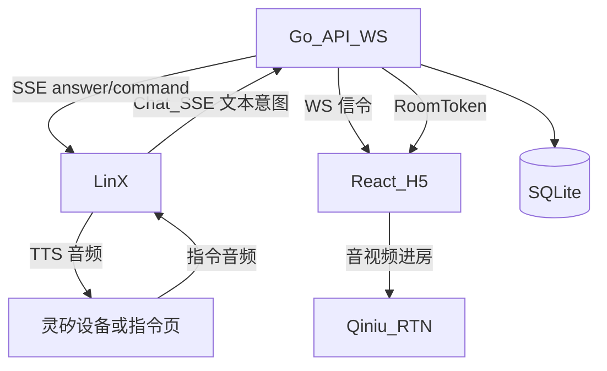
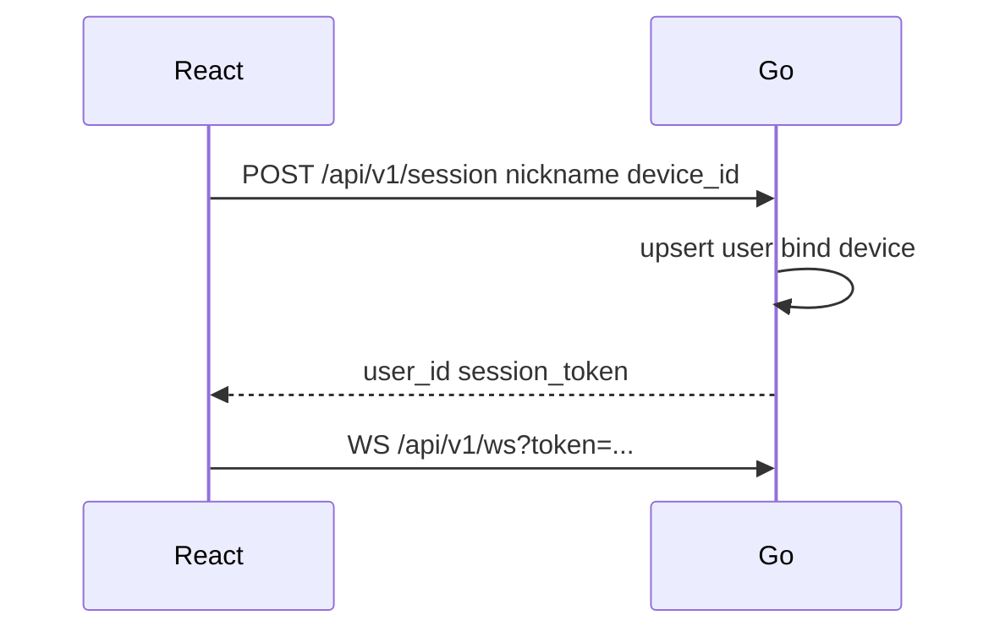
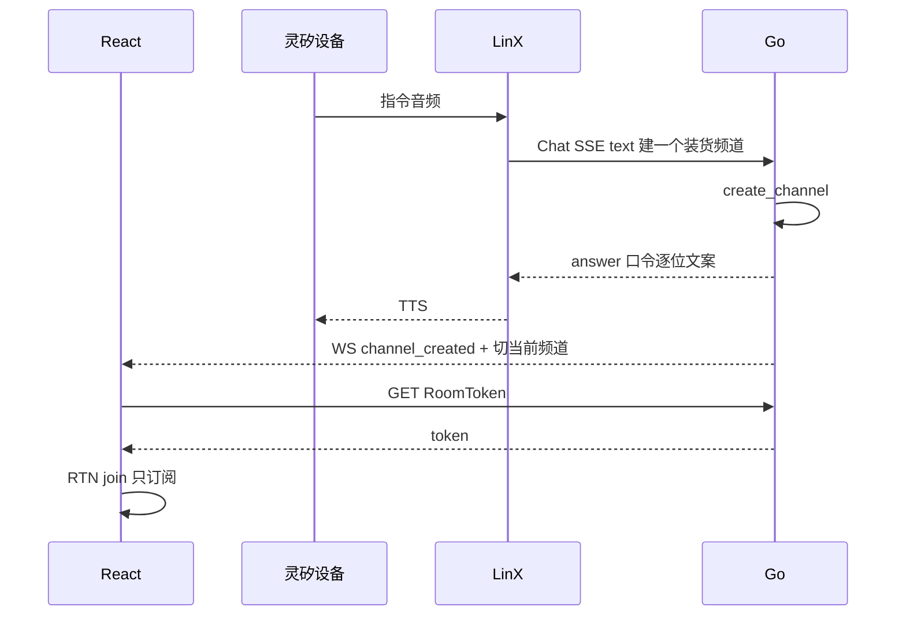
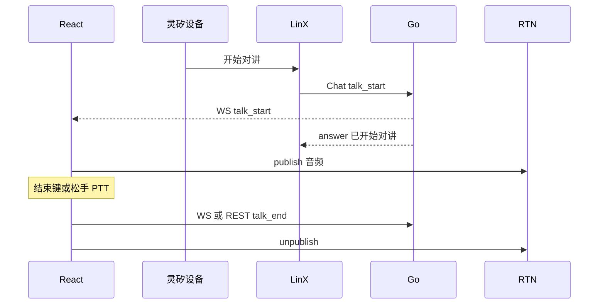
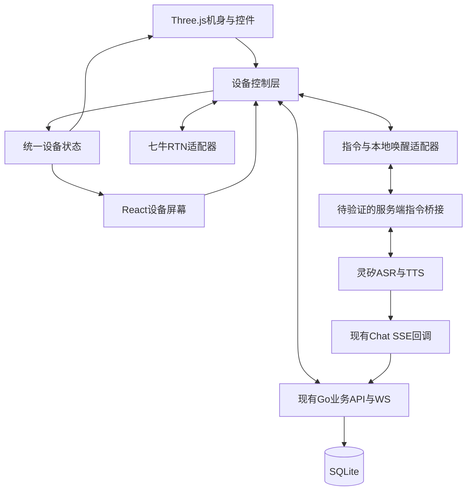

# fleet-ptt 详细技术方案

本文描述 [小路智能对讲机产品方案](./product-design.md) 的技术实现。§1–14 记录现有 H5 业务基线和接口约定；§15–20 定义下一阶段 3D 语音原型的目标架构、音频与验收。新方案尚未实现，桥接、本地唤醒及硬件 SDK 支持尚待实测。

---

## 1. 目标与范围

| 项 | 内容 |
|----|------|
| 目标 | 现有 H5 基线；下一阶段交付小路 3D 语音对讲机，见 §15–20 |
| 客户端 | React（Vite）H5 |
| 服务端 | Go（HTTP API + WebSocket 信令 + 静态资源托管） |
| 对讲 | 七牛实时音视频云 RTN（[文档](https://doc.qnsdk.com/rtn)） |
| 指令 | 灵矽第三方业务 Chat SSE（[文档](https://linx.qiniu.com/docs/xrobot/guide/third-app)） |
| 存储 | SQLite（文件挂载 volume） |
| 部署 | `make up` 一键启动（内部为 `docker compose up --build`） |
| 配置 | 仓库仅 `.env.example`；真实配置只在本地 `.env` |

---

## 2. 总体架构

指令媒体与对讲媒体分离：灵矽只处理指令链路；对讲上下行只走七牛 RTN。下图为现有双端基线，新原型架构见 §15。



| 组件 | 职责 |
|------|------|
| React H5 | UI、状态机、指令麦、PTT、RTN 订阅/发布、信令客户端 |
| Go | 用户/频道/成员、口令、RoomToken、灵矽 Chat 回调、向本机推信令 |
| 灵矽 | ASR、TTS、把用户话转文字调 Go |
| 七牛 RTN | 房间内音频转发与混音 |
| SQLite | 持久化用户、频道、成员、device 绑定 |

---

## 3. 模块划分

```
fleet-ptt/
├── web/                 # React + Vite
│   ├── src/
│   │   ├── pages/       # 昵称、对讲主界面
│   │   ├── state/       # InChannel / CommandListening / Talking
│   │   ├── rtc/         # 七牛 RTN Web SDK 封装
│   │   ├── signaling/   # 连接 Go WebSocket
│   │   └── linx/        # 当前为占位，未实现浏览器指令音频接入
│   └── ...
├── server/              # Go module
│   ├── cmd/server/      # 入口：HTTP + WS + 静态文件
│   ├── internal/
│   │   ├── api/         # REST
│   │   ├── ws/          # 信令
│   │   ├── channel/     # 频道与口令
│   │   ├── user/        # 用户与 device 绑定
│   │   ├── rtn/         # RoomToken 签发
│   │   ├── linxchat/    # 灵矽 Chat SSE 处理与意图路由
│   │   └── store/       # SQLite
│   └── ...
├── docs/
├── Dockerfile
├── docker-compose.yml
├── Makefile             # 入口：make up / down / health / server / web
├── .env.example         # 唯一入库的配置样例
└── .gitignore
```

---

## 4. 领域模型与存储

### 4.1 表结构（SQLite）

**users**

| 列 | 类型 | 说明 |
|----|------|------|
| id | TEXT PK | 用户 ID |
| display_name | TEXT | 昵称 |
| device_id | TEXT UNIQUE | 与灵矽侧设备/会话绑定 |
| created_at | INTEGER | Unix 秒 |

**channels**

| 列 | 类型 | 说明 |
|----|------|------|
| id | TEXT PK | 亦作 RTN roomName |
| name | TEXT | 展示名（装货、卸货） |
| join_code | TEXT UNIQUE | 6 位口令 |
| created_by | TEXT | users.id |
| created_at | INTEGER | |

**memberships**

| 列 | 类型 | 说明 |
|----|------|------|
| user_id | TEXT | |
| channel_id | TEXT | |
| role | TEXT | `owner` / `member` |
| PRIMARY KEY | (user_id, channel_id) | |

**user_session（当前 SQLite 持久化）**

| 列 | 类型 | 说明 |
|----|------|------|
| user_id | TEXT PK | |
| current_channel_id | TEXT | 当前频道 |
| talking | INTEGER | 0/1 是否上行 |

### 4.2 口令规则

- 6 位，字符集去掉易混字符（如不用 `0/O`、`1/I`）
- 创建频道时生成；TTS 逐位播报由灵矽侧播 Go 返回的文案完成

---

## 5. 核心时序

### 5.1 进入应用并绑定



### 5.2 语音建群（现有双端基线，经灵矽）



### 5.3 开始 / 结束对讲



PTT：按下 = publish；松开 = unpublish；可与 `talk_start`/`talk_end` 共用同一套 RTN 封装。

### 5.4 语音切群

1. 若 `talking`，先 unpublish + 清 talking  
2. 更新 `current_channel_id`，离开旧 RTN 房间、加入新房间（只订阅）  
3. TTS「已切换到 xxx」  

---

## 6. API 与协议

鉴权：MVP 用 `session_token`（创建会话时下发），Header `Authorization: Bearer <token>` 或 WS query。

### 6.1 REST

| 方法 | 路径 | 说明 |
|------|------|------|
| GET | `/healthz` | 健康检查 |
| POST | `/api/v1/session` | `{ nickname, device_id }` → user + token |
| GET | `/api/v1/channels` | 我加入的频道列表 |
| POST | `/api/v1/channels` | `{ name }` 手动建群 → channel + join_code |
| POST | `/api/v1/channels/join` | `{ code }` 或 `{ name }` |
| POST | `/api/v1/channels/current` | `{ channel_id }` 切换当前频道 |
| GET | `/api/v1/channels/:id/rtn-token` | 签发七牛 RoomToken |
| POST | `/api/v1/talk/start` | 标记 talking + 广播信令（指令路径也会调内部同一逻辑） |
| POST | `/api/v1/talk/end` | 结束上行 |
| POST | `/api/v1/linx/chat` | 灵矽 Chat SSE 回调，Bearer 为 `LINX_CHAT_TOKEN` |

### 6.2 WebSocket 信令（Go ↔ 本机 React）

客户端连接：`WS /api/v1/ws`。

服务端 → 客户端示例：

```json
{ "type": "talk_start", "channel_id": "...", "user_id": "..." }
{ "type": "talk_end", "channel_id": "...", "user_id": "..." }
{ "type": "channel_switched", "channel_id": "...", "name": "装货" }
{ "type": "channel_created", "channel_id": "...", "name": "...", "join_code": "..." }
{ "type": "members", "channel_id": "...", "members": [{ "user_id": "", "display_name": "", "talking": false }] }
{ "type": "error", "message": "未匹配到频道" }
```

客户端 → 服务端：

```json
{ "type": "talk_end" }
{ "type": "ping" }
```

`talk_start` 经灵矽到达 Go 后，必须 **WS 推到该 device 对应连接**，React 才能 publish；不能只依赖灵矽 TTS。

### 6.3 灵矽 Chat SSE（灵矽 → Go）

Go 暴露灵矽可访问的公网或内网回调，例如：

`POST /api/v1/linx/chat`（`Accept: text/event-stream`）

请求体按[第三方应用接入](https://linx.qiniu.com/docs/xrobot/guide/third-app)约定解析 `auth.device_id`、`details.msg`、`details.session_id`。

意图路由（规则 + 可选轻量 LLM，MVP 可用关键词 / 正则）：

| 用户话术模式 | 内部能力 |
|--------------|----------|
| 建…频道/群 | `create_channel` |
| 加入口令 / 进… | `join_channel` |
| 切换到 / 切到 | `switch_channel` |
| 开始对讲 | `talk_start` |
| 结束对讲 | `talk_end`（若仍走指令） |
| 我有哪些频道 | `list_my_channels` |

SSE 响应：`event: message` + `type: chat` 的 `answer` 文案供 TTS；需要时附带业务结果。`session_id` 原样回传。

口令相关 `answer` 须适合逐位朗读（如「口令是 3、8、4、2、K、9」）。

实现约定见 [灵矽接入结论](./linx-access.md)：`Authorization: Bearer <token>` 中的 token 必须等于 `LINX_CHAT_TOKEN`；`device_id` 必须已绑定用户；成功时先返回 `answer`，再返回 `message_end`。关键词路由会执行建群、入群、切群、开始或结束对讲，以及列出频道。口令按逐位文案返回；口令入群先复述确认一次。成功或失败都会推到该用户的 WebSocket，失败的 `answer` 不能为空。

---

## 7. 七牛 RTN 接入

参考：[接入流程](https://doc.qnsdk.com/rtn/docs/rtn_startup)、[Web SDK](https://doc.qnsdk.com/rtn/web)。

| 项 | 约定 |
|----|------|
| AppID | 来自七牛 RTN 控制台，仅写入本地 `.env` |
| roomName | 使用 `channel.id` |
| userId | 使用 `users.id` |
| RoomToken | **仅 Go 服务端**用 AccessKey/SecretKey 签发，短时有效 |
| 媒体 | MVP 仅音频 |
| InChannel | `join` 后只订阅远端，不 publish |
| Talking / PTT 按下 | publish 本地音频轨 |
| 结束 / 松手 | unpublish |
| 切群 | leave 旧房间 → 用新 token join |

前端使用官方 Web SDK（如 `qnweb-rtc` / 文档当前包名以官网为准），封装：

- `joinChannel(token, roomName, userId)`
- `startPublish()` / `stopPublish()`
- `leaveChannel()`
- 远端 track 订阅与「正在说」UI 钩子

---

## 8. 灵矽接入

| 项 | 约定 |
|----|------|
| 主路径 | 第三方业务 Chat SSE → Go |
| ASR/TTS | 灵矽完成 |
| device_id | 与 `users.device_id` 一致，指令才能路由到对的 WS 连接 |
| MCP | 与 Chat 同构后挂，不阻塞 MVP |

**现有 H5 双端基线：** 已按公开协议核对，结论是双页。浏览器 `WebSocket` 不能携带握手必需的 `Authorization`、`Device-Id`、`Client-Id`、`Protocol-Version`，公开文档也没有 H5 设备 SDK。指令页留在灵矽，对讲页与信令留在本仓库 React + Go，靠同一个 `device_id` 对齐。详见 [灵矽接入记录](./linx-access.md)。当前昵称页只输入昵称，设备 UUID 自动生成，没有填写灵矽设备 ID 的入口，因此这条身份对齐链路尚未完整落实。新原型采用服务端身份映射与待验证的指令接入方案，见 §17。

指令音流与 RTN 上行默认不同时占用同一采集策略：进入 `CommandListening` 时若正在 Talking，先 `stopPublish`。

---

## 9. 现有前端状态机

| 状态 | RTN | 指令麦 | UI |
|------|-----|--------|-----|
| NoChannel | 未进房 | 可开 | 引导建群/入群 |
| InChannel | 已 join，未 publish | 可开 | 可听；显示结束/PTT/指令麦 |
| CommandListening | 保持订阅；必要时已停 publish | 现有 H5 不采集，需在灵矽端说指令 | 「指令中」 |
| Talking | publish 中 | 默认不开指令 | 「正在讲」；结束键/松手 |

事件：`SESSION_OK`、`JOINED_CHANNEL`、`CMD_START`、`CMD_END`、`TALK_START`、`TALK_END`、`SWITCH_CHANNEL`、`ERROR`。

---

## 10. 配置管理

### 10.1 原则

- **仓库只提交配置样例**（`.env.example`）  
- **真实配置只在本地**（复制为 `.env` 后填写），不进入 Git  
- `docker-compose.yml`、文档、CI、代码中不得出现真实密钥  

### 10.2 样例变量（名称以 `.env.example` 为准）

| 变量 | 用途 |
|------|------|
| `HTTP_ADDR` | 监听地址，如 `:8080` |
| `SQLITE_PATH` | 如 `/data/fleet-ptt.db` |
| `SESSION_SECRET` | 签发 session 用 |
| `QINIU_ACCESS_KEY` | 七牛 AK |
| `QINIU_SECRET_KEY` | 七牛 SK |
| `QINIU_RTN_APP_ID` | RTN AppID |
| `LINX_CHAT_TOKEN` | 校验灵矽回调（若平台有约定） |
| `PUBLIC_BASE_URL` | 灵矽可访问的 Chat 回调基址 |

本地：`cp .env.example .env` 后填写。Compose：`env_file: .env`。

---

## 11. Docker 部署

### 11.1 目标

本地备好 `.env` 后，用 Make 启动。Make 是入口，实际执行 `docker compose up --build`：

```bash
make up
```

浏览器访问映射端口（如 `http://localhost:8080`）。`make health` 请求 `GET /healthz`；`make down` 停止并移除容器。

### 11.2 镜像

多阶段构建：

1. **web-build**：Node 构建 React → `dist/`  
2. **go-build**：编译 `server`，`embed` 或复制 `dist` 到镜像  
3. **runtime**：精简基础镜像，只跑二进制；数据目录 `/data`

### 11.3 Compose 契约

- 服务名：`app`  
- `env_file: .env`（文件不存在则启动失败，避免空配置误跑）  
- ports：`8080:8080`  
- volumes：`./data:/data`（gitignore）  
- healthcheck：`GET /healthz`  
- **可选 profile `tls`**：旁路 Caddy，证书目录仅本地挂载、不入库；公网演示麦克风需要 HTTPS 时启用  

`localhost` 下可用 HTTP 测麦克风；公网必须 HTTPS。

---

## 12. 安全与运维注意

| 点 | 做法 |
|----|------|
| 密钥 | 仅 `.env`；定期轮换；泄露即作废 |
| RoomToken | 短 TTL；按 user+room 签发 |
| 灵矽回调 | 校验 token / 来源；按 device_id 鉴权用户 |
| CORS | 仅必要来源；同域由 Go 托管静态则可收紧 |
| SQLite | volume 备份；单实例写入 |

---

## 13. 风险与对策

| 风险 | 对策 |
|------|------|
| H5 难当灵矽设备 | 已核对：MVP 用双页，见 [linx-access.md](./linx-access.md) |
| 口令 ASR 听错 | 逐位播报 + 入群确认 |
| 指令与对讲抢麦 | 状态机互斥；开指令先停 publish |
| 误提交密钥 | `.gitignore`；只用 `.env.example`；Code Review 检查 |
| RoomToken / 时钟 | 容器 NTP；TTL 留余量 |

---

## 14. 原 H5 实现顺序（历史基线）

1. Go：session、频道、SQLite、healthz、静态占位页  
2. RoomToken + React RTN 进房订阅 / PTT publish  
3. WebSocket 信令与 talk_start/end  
4. 灵矽 Chat 回调与意图路由  
5. 指令麦联调与切群  
6. Dockerfile / Compose / Makefile 与 `.env.example` 打通一键启动  


## 15. 小路 3D 原型目标架构

产品角色名固定为“小路”；首版拟用唤醒词“你好小路”，识别引擎与最终词形需经噪声测试确定。核心操作通过语音完成，仅保留电源、指令/结束和 PTT 三个控件。



先提取 `ChannelPage`、`TalkPanel` 中的业务编排，复用 `state/`、`rtc/`、`signaling/`、频道服务和 Chat 回调；不要复制一套业务供 3D 使用。控制层暴露开关机、PTT 按下/松开、指令开始/结束/取消、频道操作与音量操作。3D 点击只调用控制动作，不直接访问 HTTP、数据库或七牛 SDK。

状态分为电源与连接、业务音频、屏幕导航。服务端信令代表业务意图；本地媒体成功决定“正在发送”“可收听”等 UI。指令编号应关联采集、识别、确认、执行和反馈；已取消或过期指令的迟到结果不得重新开麦或切群。具体事件和接口在协议验证后确定，此处不宣称已新增 API。

## 16. 3D 资产与屏幕

建议以 Three.js 渲染 GLB 机身，React/HTML 渲染对齐屏幕平面的 UI。先完成几何灰模与命中区，再制作正式资产。本次仅更新设计，不安装依赖。

| 项 | 约定 |
|----|------|
| 模型节点 | 机身、PTT、指令/结束键、电源键、屏幕、指示灯分别命名 |
| 轴心 | 按键符合按压方向，模型统一单位和坐标方向 |
| 预算 | 初始目标 3–5 万三角面、1K 为主的纹理、资源合计尽量不超过 5 MB；以目标手机实测调整 |
| 相机 | 默认正面偏转约 15°；背景拖动观察，按钮操作不旋转机身 |
| 屏幕 | 约 240 × 320 逻辑布局；HTML 文字、输入和二维码保持清晰 |
| 遮挡 | 转到背面时隐藏屏幕 HTML，避免穿透机身；保证控件命中顺序 |
| 渲染 | 不默认添加重型后处理；静止且无动画时减少重绘 |
| 可访问性 | 按键名称、键盘操作、足够命中区、文字与颜色共同提示 |

手机默认固定操作视角。外部 UI 仅提供观察辅助，不承担频道或语音业务。二维码取景可使用宿主摄像头，但不得推断未来硬件自带摄像头。

## 17. 原型内指令接入与身份

### 17.1 接入验证

现有浏览器不具备灵矽设备协议所需的自定义 WebSocket 握手头。优先核实是否有适用的官方 Web 接入；若没有，验证“浏览器音频 → 本服务指令 WebSocket → 灵矽设备连接”的桥接方案。双页只能保留为基线，不满足新原型最终验收。

协议验证必须覆盖：设备注册/授权、握手、上行格式、采样率与帧长、结束采集标志、TTS 音频格式与播放、断线释放、并发会话限制，以及 ASR 文本是否实时可获得。不能假定 `MediaRecorder` 默认输出可直接发送；根据平台支持选择 AudioWorklet PCM 或明确匹配的编码方式。未支持实时文字时显示采集状态和最终识别文字，不模拟实时 ASR。

桥接服务使用应用会话鉴权，服务端保管灵矽凭证，仅连接配置好的灵矽端点。浏览器不能指定任意设备身份或任意转发目标。停止、取消与关机应关闭相应上游会话，并忽略该次指令后续回调。

### 17.2 身份绑定

当前应用 `device_id` 是浏览器生成的 UUID，灵矽设备 ID 可能采用伪 MAC。目标设计保留两者独立身份，在服务端建立经授权的映射；不要求字符串相同，不让用户修改 localStorage 对齐设备。

现有 `users.device_id`、Chat 按设备查人逻辑和 WS 路由均需评估迁移。映射应确定目标设备连接，避免同用户多个客户端同时执行开麦。设备 ID 用于定位，不是身份凭证；绑定必须验证设备归属。具体表结构、绑定流程和接口需在接入验证后形成实现规格，本次不执行数据库迁移。

### 17.3 语音首次设置

现有应用在昵称会话建立后才能执行业务回调，新原型还需要语音设置昵称。实现前必须明确首次注册的设备凭证与受限指令会话：先建立经过验证的设备上下文，只允许初始化昵称与绑定；完成后签发正常用户会话。不能为支持首次语音而开放未鉴权的通用回调或音频代理。浏览器首次麦克风授权仍需用户手势。

## 18. 音频、唤醒与动作执行

### 18.1 采集与路由

同一设备需要统一管理麦克风生命周期：本地唤醒在待命和对讲时可用，指令上行与 RTN 对讲上行互斥。必须验证七牛 Web SDK 能否使用可供本地分析的采集轨，或能否复用同一采集源；若不支持，先验证替代采集方式，不能假定两个 SDK 同时开麦稳定。

- 本地唤醒不上传完整待命音频；仅保留支持连续说法所需的短时内存音频，不持久化录音。
- 唤醒后先关闭 RTN 上行，再把本轮指令交给灵矽；停止动作不等待远端 HTTP 成功。
- PTT 松开、取消、失焦时即刻解除发送意图，异步开麦完成后仍检查是否已取消。
- TTS 期间暂停唤醒触发和指令上传；指令期间降低/暂停远端播放；结束后恢复。
- “开始对讲”先完成反馈音，再发布媒体；不能只收到 `talk_start` 就在 TTS 中开麦。
- 停止发布不一定意味着销毁采集：待命需要本地唤醒，关机则必须销毁全部采集与播放资源。
- 网络恢复、取消、识别失败不得自动恢复之前的持续讲话。

首版接受检测完成前的唤醒词片段可能传给频道。检测后指令音频不可继续进入频道；不承诺零片段泄露，也不默认引入增加对讲延迟的发送缓冲。

### 18.2 唤醒与对话

唤醒引擎需验证“你好小路”的自定义支持、浏览器运行能力、授权、资源消耗、驾驶室噪声与误唤醒率。硬件端另行验证常驻低功耗实现，浏览器锁屏/后台不作为可用性承诺。

本轮补充参数和确认无需重新唤醒；监听超时与业务确认 TTL 分开。昵称、口令等待确认事项限定在当前设备与指令上下文，执行后清除。本地动作如调整音量和显示二维码也经过统一控制层执行，回执到达后才能反馈成功。

### 18.3 意图能力

先扩展现有关键词/槽位解析，覆盖产品方案中的话术、中文数字口令、确认与取消。需要更自由表达时再评估受约束的模型解析，只能输出允许的动作和参数；权限、参数校验与执行继续由业务服务负责。

新增动作包括上一频道、播放音量、讲话成员查询、展示/播报口令、展示二维码和昵称确认。复用现有建群、入群、切群与 talk 逻辑。频道序号和上一频道以设备当前业务上下文为准；媒体失败时保留可恢复状态并明确反馈，不伪报成功。

## 19. 硬件适配边界

真实硬件继承操作语义、设备状态和业务协议，无需运行 3D 场景。浏览器点击替换为 GPIO/系统按键，HTML 屏幕替换为原生 UI，音频替换为目标平台驱动与 SDK。

主控选型前核实七牛 RTN、灵矽和本地唤醒在目标 Android/Linux/MCU 上的支持。麦克风、扬声器、回声消除、续航、弱网和后台常驻均需真机验证。当前会话基于设备 ID 的昵称进入与无过期令牌属于 MVP 简化，不作为量产设备认证方案。

## 20. 交付与验证

1. 灰模、三个控件、屏幕和设备控制层：确认现有业务无需页面外按钮即可操作。
2. 尽早验证灵矽指令桥接与采集格式，再完成原型内按键唤醒闭环。
3. 接入本地唤醒、连续说法、对讲中打断与确认，完成免手动核心流程。
4. 正式模型、材质、灯光和动画收尾，再进行目标设备性能与声学验收。

开发时按改动运行针对性测试：控制层状态转换、PTT 快速松开、迟到回调取消、音频互斥、身份路由、口令归一化/确认、现有频道与信令回归。文档修改无需运行业务测试。

人工/授权浏览器联调覆盖模型命中与遮挡、麦克风授权、两个独立客户端真实通话、灵矽 ASR/TTS、对讲中唤醒、播报与远端回声。记录浏览器/硬件、噪声条件、成功/失败与延迟；本地测试通过不代表外部平台联调或远端 CI 通过。

完成标准：首次授权后，用户可通过“小路”语音完成昵称设置、建群、确认入群、切群/回切、开始/结束对讲、音量和邀请查询；三按键随时提供兜底，关机后资源释放。桥接、本地唤醒、身份初始化有任何未验证项，必须明确列出，不标记整体验收完成。
