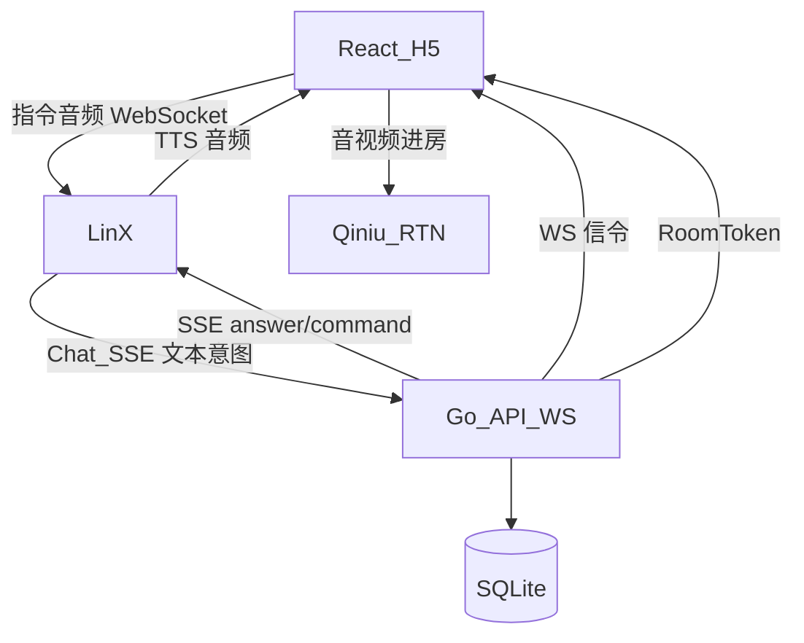
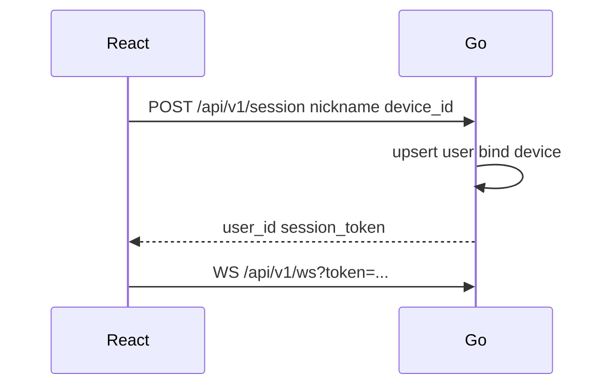
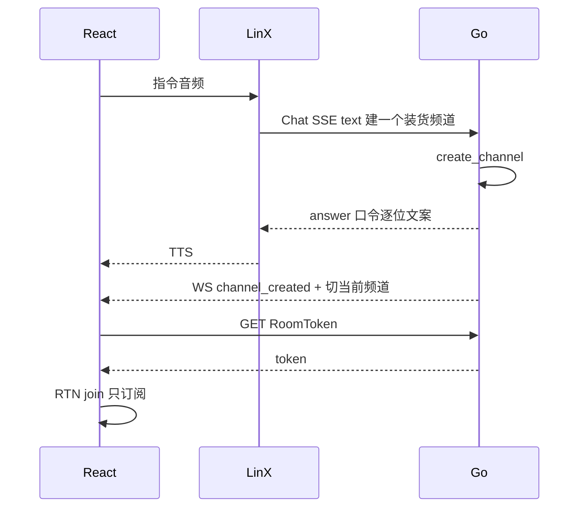
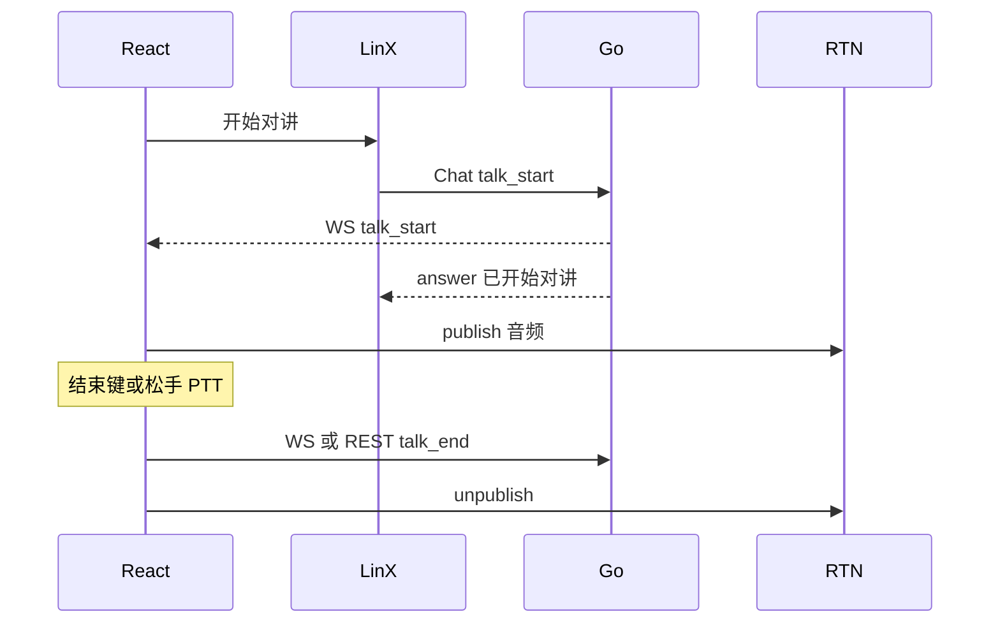

# fleet-ptt 详细技术方案

本文描述如何实现 [产品设计方案](./product-design.md)：架构、模块、数据、协议、七牛 RTN、灵矽接入与 Docker 部署。产品「做什么」见产品方案；本文只写「怎么做」。

---

## 1. 目标与范围

| 项 | 内容 |
|----|------|
| 目标 | 交付可演示的 H5 车队对讲：语音指令（灵矽）+ 群对讲（七牛 RTN） |
| 客户端 | React（Vite）H5 |
| 服务端 | Go（HTTP API + WebSocket 信令 + 静态资源托管） |
| 对讲 | 七牛实时音视频云 RTN（[文档](https://doc.qnsdk.com/rtn)） |
| 指令 | 灵矽第三方业务 Chat SSE（[文档](https://linx.qiniu.com/docs/xrobot/guide/third-app)） |
| 存储 | SQLite（文件挂载 volume） |
| 部署 | `docker compose up --build` 一键启动 |
| 配置 | 仓库仅 `.env.example`；真实配置只在本地 `.env` |

---

## 2. 总体架构

指令媒体与对讲媒体分离：灵矽只处理指令链路；对讲上下行只走七牛 RTN。



| 组件 | 职责 |
|------|------|
| React H5 | UI、状态机、指令麦、PTT、RTN 订阅/发布、信令客户端 |
| Go | 用户/频道/成员、口令、RoomToken、灵矽 Chat 回调、向本机推信令 |
| 灵矽 | ASR、TTS、把用户话转文字调 Go |
| 七牛 RTN | 房间内音频转发与混音 |
| SQLite | 持久化用户、频道、成员、device 绑定 |

---

## 3. 模块划分

```
fleet-ptt/
├── web/                 # React + Vite
│   ├── src/
│   │   ├── pages/       # 昵称、对讲主界面
│   │   ├── state/       # InChannel / CommandListening / Talking
│   │   ├── rtc/         # 七牛 RTN Web SDK 封装
│   │   ├── signaling/   # 连接 Go WebSocket
│   │   └── linx/        # 指令麦 / 与灵矽会话（或嵌入官方入口）
│   └── ...
├── server/              # Go module
│   ├── cmd/server/      # 入口：HTTP + WS + 静态文件
│   ├── internal/
│   │   ├── api/         # REST
│   │   ├── ws/          # 信令
│   │   ├── channel/     # 频道与口令
│   │   ├── user/        # 用户与 device 绑定
│   │   ├── rtn/         # RoomToken 签发
│   │   ├── linxchat/    # 灵矽 Chat SSE 处理与意图路由
│   │   └── store/       # SQLite
│   └── ...
├── docs/
├── Dockerfile
├── docker-compose.yml
├── .env.example         # 唯一入库的配置样例
└── .gitignore
```

---

## 4. 领域模型与存储

### 4.1 表结构（SQLite）

**users**

| 列 | 类型 | 说明 |
|----|------|------|
| id | TEXT PK | 用户 ID |
| display_name | TEXT | 昵称 |
| device_id | TEXT UNIQUE | 与灵矽侧设备/会话绑定 |
| created_at | INTEGER | Unix 秒 |

**channels**

| 列 | 类型 | 说明 |
|----|------|------|
| id | TEXT PK | 亦作 RTN roomName |
| name | TEXT | 展示名（装货、卸货） |
| join_code | TEXT UNIQUE | 6 位口令 |
| created_by | TEXT | users.id |
| created_at | INTEGER | |

**memberships**

| 列 | 类型 | 说明 |
|----|------|------|
| user_id | TEXT | |
| channel_id | TEXT | |
| role | TEXT | `owner` / `member` |
| PRIMARY KEY | (user_id, channel_id) | |

**user_session（可选，可内存）**

| 列 | 类型 | 说明 |
|----|------|------|
| user_id | TEXT PK | |
| current_channel_id | TEXT | 当前频道 |
| talking | INTEGER | 0/1 是否上行 |

### 4.2 口令规则

- 6 位，字符集去掉易混字符（如不用 `0/O`、`1/I`）
- 创建频道时生成；TTS 逐位播报由灵矽侧播 Go 返回的文案完成

---

## 5. 核心时序

### 5.1 进入应用并绑定



### 5.2 语音建群（经灵矽）



### 5.3 开始 / 结束对讲



PTT：按下 = publish；松开 = unpublish；可与 `talk_start`/`talk_end` 共用同一套 RTN 封装。

### 5.4 语音切群

1. 若 `talking`，先 unpublish + 清 talking  
2. 更新 `current_channel_id`，离开旧 RTN 房间、加入新房间（只订阅）  
3. TTS「已切换到 xxx」  

---

## 6. API 与协议

鉴权：MVP 用 `session_token`（创建会话时下发），Header `Authorization: Bearer <token>` 或 WS query。

### 6.1 REST

| 方法 | 路径 | 说明 |
|------|------|------|
| GET | `/healthz` | 健康检查 |
| POST | `/api/v1/session` | `{ nickname, device_id }` → user + token |
| GET | `/api/v1/channels` | 我加入的频道列表 |
| POST | `/api/v1/channels` | `{ name }` 手动建群 → channel + join_code |
| POST | `/api/v1/channels/join` | `{ code }` 或 `{ name }` |
| POST | `/api/v1/channels/current` | `{ channel_id }` 切换当前频道 |
| GET | `/api/v1/channels/:id/rtn-token` | 签发七牛 RoomToken |
| POST | `/api/v1/talk/start` | 标记 talking + 广播信令（指令路径也会调内部同一逻辑） |
| POST | `/api/v1/talk/end` | 结束上行 |

### 6.2 WebSocket 信令（Go ↔ 本机 React）

客户端连接：`WS /api/v1/ws`。

服务端 → 客户端示例：

```json
{ "type": "talk_start", "channel_id": "...", "user_id": "..." }
{ "type": "talk_end", "channel_id": "...", "user_id": "..." }
{ "type": "channel_switched", "channel_id": "...", "name": "装货" }
{ "type": "channel_created", "channel_id": "...", "name": "...", "join_code": "..." }
{ "type": "members", "channel_id": "...", "members": [{ "user_id": "", "display_name": "", "talking": false }] }
{ "type": "error", "message": "未匹配到频道" }
```

客户端 → 服务端：

```json
{ "type": "talk_end" }
{ "type": "ping" }
```

`talk_start` 经灵矽到达 Go 后，必须 **WS 推到该 device 对应连接**，React 才能 publish；不能只依赖灵矽 TTS。

### 6.3 灵矽 Chat SSE（灵矽 → Go）

Go 暴露灵矽可访问的公网或内网回调，例如：

`POST /api/v1/linx/chat`（`Accept: text/event-stream`）

请求体按[第三方应用接入](https://linx.qiniu.com/docs/xrobot/guide/third-app)约定解析 `auth.device_id`、`details.msg`、`details.session_id`。

意图路由（规则 + 可选轻量 LLM，MVP 可用关键词 / 正则）：

| 用户话术模式 | 内部能力 |
|--------------|----------|
| 建…频道/群 | `create_channel` |
| 加入口令 / 进… | `join_channel` |
| 切换到 / 切到 | `switch_channel` |
| 开始对讲 | `talk_start` |
| 结束对讲 | `talk_end`（若仍走指令） |
| 我有哪些频道 | `list_my_channels` |

SSE 响应：`event: message` + `type: chat` 的 `answer` 文案供 TTS；需要时附带业务结果。`session_id` 原样回传。

口令相关 `answer` 须适合逐位朗读（如「口令是 3、8、4、2、9、1」）。

---

## 7. 七牛 RTN 接入

参考：[接入流程](https://doc.qnsdk.com/rtn/docs/rtn_startup)、[Web SDK](https://doc.qnsdk.com/rtn/web)。

| 项 | 约定 |
|----|------|
| AppID | 来自七牛 RTN 控制台，仅写入本地 `.env` |
| roomName | 使用 `channel.id` |
| userId | 使用 `users.id` |
| RoomToken | **仅 Go 服务端**用 AccessKey/SecretKey 签发，短时有效 |
| 媒体 | MVP 仅音频 |
| InChannel | `join` 后只订阅远端，不 publish |
| Talking / PTT 按下 | publish 本地音频轨 |
| 结束 / 松手 | unpublish |
| 切群 | leave 旧房间 → 用新 token join |

前端使用官方 Web SDK（如 `qnweb-rtc` / 文档当前包名以官网为准），封装：

- `joinChannel(token, roomName, userId)`
- `startPublish()` / `stopPublish()`
- `leaveChannel()`
- 远端 track 订阅与「正在说」UI 钩子

---

## 8. 灵矽接入

| 项 | 约定 |
|----|------|
| 主路径 | 第三方业务 Chat SSE → Go |
| ASR/TTS | 灵矽完成 |
| device_id | 与 `users.device_id` 一致，指令才能路由到对的 WS 连接 |
| MCP | 与 Chat 同构后挂，不阻塞 MVP |

**H5 作为灵矽设备：** 实现前验证 WebSocket 伪设备或官方 Web/小程序入口。若 H5 无法直连，采用「指令页（灵矽）+ 对讲页（本应用）」双页，靠同一 `device_id` / 账号绑定对齐；对讲与信令仍在本仓库 React + Go。

指令音流与 RTN 上行默认不同时占用同一采集策略：进入 `CommandListening` 时若正在 Talking，先 `stopPublish`。

---

## 9. 前端状态机

| 状态 | RTN | 指令麦 | UI |
|------|-----|--------|-----|
| NoChannel | 未进房 | 可开 | 引导建群/入群 |
| InChannel | 已 join，未 publish | 可开 | 可听；显示结束/PTT/指令麦 |
| CommandListening | 保持订阅；必要时已停 publish | 采集送灵矽 | 「指令中」 |
| Talking | publish 中 | 默认不开指令 | 「正在讲」；结束键/松手 |

事件：`SESSION_OK`、`JOINED_CHANNEL`、`CMD_START`、`CMD_END`、`TALK_START`、`TALK_END`、`SWITCH_CHANNEL`、`ERROR`。

---

## 10. 配置管理

### 10.1 原则

- **仓库只提交配置样例**（`.env.example`）  
- **真实配置只在本地**（复制为 `.env` 后填写），不进入 Git  
- `docker-compose.yml`、文档、CI、代码中不得出现真实密钥  

### 10.2 样例变量（名称以 `.env.example` 为准）

| 变量 | 用途 |
|------|------|
| `HTTP_ADDR` | 监听地址，如 `:8080` |
| `SQLITE_PATH` | 如 `/data/fleet-ptt.db` |
| `SESSION_SECRET` | 签发 session 用 |
| `QINIU_ACCESS_KEY` | 七牛 AK |
| `QINIU_SECRET_KEY` | 七牛 SK |
| `QINIU_RTN_APP_ID` | RTN AppID |
| `LINX_CHAT_TOKEN` | 校验灵矽回调（若平台有约定） |
| `PUBLIC_BASE_URL` | 灵矽可访问的 Chat 回调基址 |

本地：`cp .env.example .env` 后填写。Compose：`env_file: .env`。

---

## 11. Docker 部署

### 11.1 目标

本地备好 `.env` 后：

```bash
docker compose up --build
```

浏览器访问映射端口（如 `http://localhost:8080`）。

### 11.2 镜像

多阶段构建：

1. **web-build**：Node 构建 React → `dist/`  
2. **go-build**：编译 `server`，`embed` 或复制 `dist` 到镜像  
3. **runtime**：精简基础镜像，只跑二进制；数据目录 `/data`

### 11.3 Compose 契约

- 服务名：`app`  
- `env_file: .env`（文件不存在则启动失败，避免空配置误跑）  
- ports：`8080:8080`  
- volumes：`./data:/data`（gitignore）  
- healthcheck：`GET /healthz`  
- **可选 profile `tls`**：旁路 Caddy，证书目录仅本地挂载、不入库；公网演示麦克风需要 HTTPS 时启用  

`localhost` 下可用 HTTP 测麦克风；公网必须 HTTPS。

---

## 12. 安全与运维注意

| 点 | 做法 |
|----|------|
| 密钥 | 仅 `.env`；定期轮换；泄露即作废 |
| RoomToken | 短 TTL；按 user+room 签发 |
| 灵矽回调 | 校验 token / 来源；按 device_id 鉴权用户 |
| CORS | 仅必要来源；同域由 Go 托管静态则可收紧 |
| SQLite | volume 备份；单实例写入 |

---

## 13. 风险与对策

| 风险 | 对策 |
|------|------|
| H5 难当灵矽设备 | 先验证；不行则双页 + device 绑定 |
| 口令 ASR 听错 | 逐位播报 + 入群确认 |
| 指令与对讲抢麦 | 状态机互斥；开指令先停 publish |
| 误提交密钥 | `.gitignore`；只用 `.env.example`；Code Review 检查 |
| RoomToken / 时钟 | 容器 NTP；TTL 留余量 |

---

## 14. 实现顺序建议

1. Go：session、频道、SQLite、healthz、静态占位页  
2. RoomToken + React RTN 进房订阅 / PTT publish  
3. WebSocket 信令与 talk_start/end  
4. 灵矽 Chat 回调与意图路由  
5. 指令麦联调与切群  
6. Dockerfile / Compose 与 `.env.example` 打通一键启动  
